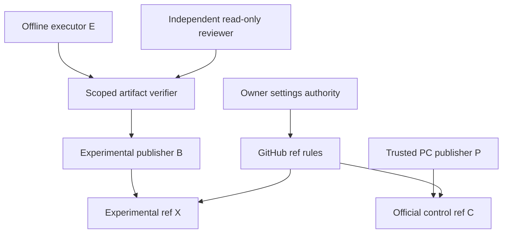

# PP-002 Q02 B1 — Real Permission Boundary and Six-Gate Security Design

artifact_id: PP-002-Q02-B1-PERMISSION-ISOLATION-DESIGN-HANDOFF
assignment: B1-SEC-DES-001
status: DESIGN READY FOR PC-003 REVIEW / B1 IMPLEMENTATION NO-GO
author / design closer: PROTOCOL_PORTABILITY / PP-002
return_to: PROJECT_CONTROL / PC-003
repository: KhaosMagnus/YU3DOH-Carder
activation_control: 6576f059fae69f39a75f57092326e5c9c65d66e5
owner_decision: control/PP-002_Q02_B1_OWNER_SIX_GATE_DECISION.md
frozen_scope: control/PP-002_Q02_B1_SECURITY_DESIGN_SCOPE.md
authorization: control/PP-002_Q02_B1_SECURITY_DESIGN_AUTHORIZATION.md
route: routing/ROUTE-PP-002-Q02-B1-SECURITY-DESIGN.md
accepted_Q02_design_blob: a06fb711662848ccc16d2e32d621be279a9b1f4d
Q01: INDEPENDENT OFFLINE PASS / UNCHANGED
Q02-DES-001: ACCEPTED / UNCHANGED
Q02-PROT-001: NOT AUTHORIZED
S1_proven: NO
S2_proven: NO
implementation / settings_changes / credential_material_handling / negative_write_probes / tests: NONE
Gate_C / final_PP-002: REVISE / UNCHANGED
P01: UNCERTAIN
P02: UNKNOWN
generic_protocols: FROZEN / UNCHANGED
protocol_successor / adoption: NOT AUTHORIZED

## 1. Decision and priority

**B1 is designable in principle, but the observed configuration is NO-GO for
implementation.** Do not authorize Q02-PROT-001 on the current shared connection
or waive S1/S2 because its Python tests would be offline. Separate branches do
not create separate effective privileges.

The minimum defensible B1 architecture has:
- an experimental executor with no credentials, network or production connector;
- a separately controlled experimental publication identity and route, unable
  to select or obtain the PC/admin route;
- effective server-side protection of all official refs, with only a narrowly
  identified PC publisher allowed to advance the official control ref;
- a trusted publication boundary enforcing exact paths, source pins and allowed
  operations, because branch restrictions alone are not a per-path sandbox;
- independent evidence of those boundaries before provisioning the B1 branch.

Those are proposed controls, not installed facts. They require separate Owner
authorization for settings, identity provisioning and bounded qualification.
This handoff authorizes none of them. [OWNER] [AUTH] [SCOPE]

If the current platform cannot bind the experimental context to a genuinely
different, limited route, choose a separately permissioned B2 repository and
executor through a new scope. Creating B2 while retaining the same unrestricted
all-repositories connection would not solve S1. B2 is a fallback recommendation,
not an automatic GO or a waiver of the six mandatory gates.

The immediate next decision is whether to authorize a bounded security
configuration/qualification phase, or redesign on B2. It is not permission to
implement the prototype first and prove isolation later.

## 2. Observed facts, inference and uncertainty

### Frozen preflight and independent read-only refresh

[PREFLIGHT] records public visibility, 47 returned unprotected branches, an empty
rulesets response, authenticated login KhaosMagnus with admin/push metadata, and
installation 162412374 with repository_selection=all. It explicitly did not
establish the signing token's effective permission map or separate per-chat
identities.

This review made fresh public repository/ruleset/branch GETs only:

| Observation | Returned fact | Receipt boundary, UTC |
|---|---|---|
| GET /repos/KhaosMagnus/YU3DOH-Carder | private=false; owner.type=User; default_branch=main; permissions admin/push/maintain/pull/triage=true | 2026-10-31T01:08:19.054Z |
| GET /repos/KhaosMagnus/YU3DOH-Carder/rulesets?includes_parents=true | Empty array | 2026-10-31T01:08:19.033Z |
| GET /repos/KhaosMagnus/YU3DOH-Carder/branches?per_page=100 | 47 returned; each protected=false; proposed experiment branch absent | 2026-10-31T01:08:19.122Z |

All three invocations began at 2026-10-31T01:08:18.582Z. These timestamps are
caller tool invocation/completed-response boundaries, not GitHub HTTP-wire
timestamps. The raw returned UTF-8 response SHA-256 values, in table order, are:

- 763eb1cd0c9aed6c7590efa8e1b7b05e80cc19ecb6f6bdd6e8f11e1ef9b7a78d
- 4f53cda18c2baa0c0354bb5f9a3ecbe5ed12ab4d8e11ba873c2f11161202b945
- 61d233fd1c47cf59d347c7893235d796979e19b14221d6b20046d25a8d536ef5

The 47-entry response includes main, meta/project-control, 30 feature branches,
two fix branches, twelve ops branches and one recovery branch. The six special
product/historical operational refs are pinned in section 17. An empty rulesets
response and false branch flags are the observed metadata, not a proof that
every inaccessible control in every system is absent.

OBSERVED: installation-selection and login claims come from the frozen PC-003
preflight. This review did not inspect a credential, mint a token, call a user/
installation secret endpoint, or independently identify the credential attached
to each connector call. Public owner identity and returned user permission flags
do not establish a particular App token's rights.

INFERENCE: current evidence does not support either S1 or S2. The default branch
and official control refs are not marked protected in the returned inventory;
a voluntary expected-head helper is not a system-wide authorization boundary.

UNKNOWN: actual per-call authentication mode, App registration ID, effective
token repositories/permissions, selectable fallback connections, deployment
identity, app signing-key custody and real isolation of the experimental actor.
No claim that a forbidden write succeeded or that every future B1 configuration
must fail is made.

### Native mechanisms and their limits

GitHub documents public-repository branch/tag rulesets, active rule aggregation
and repository-admin ability to edit rules. Restrict creation/update/deletion
controls have bypass actors; overlapping rulesets remain applicable. This
supports a layered proposal, not evidence it is installed. [GH1] [GH2] [GH3]

Repository selection and token scopes are distinct. Installation tokens may
narrow repositories and permissions; user-authorized and installation
authentication have different permission semantics. Therefore all-repositories
installation metadata is a risk indicator, not proof that a particular token
holds every right. Conversely, a second token is not proof of independent
principal/ref isolation. [GH5] [GH6] [GH9]

The documented push-rule path restrictions concern private/internal repositories
and their fork networks, not a native per-branch path allowlist for this public
repository. A broker/path verifier remains necessary. Also, Contents write can
authorize release operations; ref rules alone are not an API-operation allowlist.
[GH1] [GH8]

## 3. Threat model and security boundary

In scope:
- inadvertent omitted/wrong branch, default-main fallback, stale CAS or extra
  commit parents;
- buggy or hostile prototype code trying to reach a production connector,
  credential, privileged host, extra path/ref or network service;
- shared App/user routes, wrong identity selection and direct create/update-file
  or Git transport bypasses;
- forged approval/index, reviewer impersonation and self-acceptance;
- secret-bearing input/output and unintended publication in a public repository;
- out-of-band administrative changes and loss of an acknowledgement during
  configuration or publication.

Trusted roots that must be explicit and independently reviewed: GitHub/provider
enforcement, the Owner-controlled settings administrator, the minimal credential
issuer/publication boundary, and the independent verification channel. A
compromised platform or Owner able to remove every control cannot be defeated by
a repository ruleset owned by that same administrator. Record that residual risk;
do not describe it as zero or claim a mock proves otherwise.

The prototype executor is outside the trusted publication boundary. It can emit
a proposed file bundle, not choose arbitrary authenticated tools or obtain a
token. Its output is data until inspected; the privileged publisher must not
import/execute candidate code, hooks, build scripts or archive instructions.

There is deliberately no E-to-P or E-to-admin credential edge. If the same agent
context can still call the shared privileged connector directly, that edge
exists in reality and S1 is NO-GO, regardless of the diagram.

## 4. Actual identities versus proposed actors

No new account, App, installation, identity or role assignment exists because
this document names it. Proposed identity IDs below remain UNPROVISIONED.

| Actor/function | Actual evidence now | Proposed effective boundary |
|---|---|---|
| Owner/settings administrator A | KhaosMagnus is repository owner; preflight reports authenticated login of that name and admin/push metadata | Trusted human/admin channel for separately authorized settings; never available to experimental execution |
| PC coordinator / publisher P | PC-003 is the governance instance, not a proved separate GitHub principal; current signing route unresolved | Dedicated verified publisher principal, preferably a separate GitHub App registration; repo-limited, no Administration/Actions/Workflows grant |
| Experimental code/evidence publisher B | No independent identity established | Different verified App/principal from P; repository Contents write only behind the scoped publication boundary; bypass only exact X update rule |
| Branch provisioner C0 | No actor assigned | Separate, narrowly authorized actor for absent X creation at the approved SHA; cannot use B's execution context |
| Offline implementer/executor E | PP-002 role label is not a credential proof | No GitHub principal/token, broker credential, MCP/connector access or writable privileged host; only isolated local input/output |
| Independent security verifier / DESIGN_QA Q | No new reviewer is activated here | Independently assigned; read-only settings/source evidence and isolated tests; cannot change settings or self-approve implementation |
| Emergency administrator G | No separate emergency identity/custody proven | Owner-controlled recovery channel outside E/B/P routine credentials; no standing broad bypass |
| Existing installation | ID 162412374, selection=all reported by PC-003 | Do not map it to P or B without actual App/credential evidence; do not use it as a blanket isolation claim |

For every effective actor, the later acceptance packet must contain nonsecret
evidence of: immutable account/App ID, App registration versus installation ID,
resource owner and repository IDs, authentication mode, actual granted and
requested permissions, token repository set/expiry where applicable, issuance
authority, route selection and inaccessible alternative routes.

A GitHub App bypass entry identifies an App/integration, not a chat and not the
observed installation ID by itself. Do not enter installation 162412374 as though
it established a separate App bypass identity. If P and B resolve to the same
bypass-capable App/principal in the same repository, that is NO-GO under the
mandatory Owner separation decision. Do not introduce a same-principal exception
to make B1 proceed. A materially different provider security model would need
a new explicit Owner disposition, not a designer's waiver. Different token
strings or chat names are insufficient.

A practical default is separate App registrations for P and B. C0 can be a
separately verified explicit Owner identity if the actual account/API supports
that exact-identity entry, otherwise a dedicated narrowly scoped provisioning
App. It must never be replaced by a blanket admin/write-role bypass for
convenience. No concrete IDs are fabricated here.

## 5. Actor / operation / resource permission matrix

C = refs/heads/meta/project-control.
X = refs/heads/experiment/pp002-q02-prot-001, still PROPOSED/ABSENT.
O = every other existing/future branch; T = all tags.

| Actor | C | X | O / T | Settings / other APIs | Execution / data access |
|---|---|---|---|---|---|
| A/G, separately authorized | No routine privileged ref bypass | Only explicit provisioning/recovery action | No routine bypass; settings power remains a trusted root | Can administer only under a new named scope and independent audit | No experimental runtime access to A/G session or credential |
| P | Append authorized documentation using exact HEAD/CAS and whole-tree/path checks | No experimental update/creation permission | No bypass | No settings, Actions, Workflows, release, issue/PR or arbitrary authenticated operation exposed by publisher | Does not execute candidate payloads |
| B | Denied by server-side C update rule | Only scoped additive publication after validation; no creation/deletion/force | Denied by server-side O/T rules | No Administration/Actions/Workflows grants; fixed endpoint boundary denies releases and unrelated operations | Credential stays in trusted boundary, not E |
| C0 | No update permission | Create once at frozen source SHA when absent; no subsequent update/delete | Denied | No settings privilege needed for routine creation; no arbitrary caller-chosen ref | Provisioning activity is outside offline prototype execution |
| E | No write route | Local proposal only, no direct GitHub call | No write route | No credential, connector, network, host escape or alternate writer | Read-only staged baseline/corpus, writable bounded scratch outputs |
| Q | Read-only | Read exact candidate/tree and evidence | Read public/source/config evidence as authorized | No settings changes or production write probes | Independent offline QA; result relayed by authorized documentation path |

Repository-level grants alone do not implement the path/API columns. P and B's
trusted boundaries must constrain methods, repository ID, exact refs, paths,
parent/expected head and file modes; reject absent/default branch arguments and
arbitrary additional parents. Their credential must not be obtainable through a
local file, environment, host socket or a second connector tool.

Separate publication can be a minimal independently operated process or manual
reviewer-controlled route; an always-on service is not assumed. If current
ChatGPT connection selection cannot enforce the intended separation, use an
external isolated executor/publication route or redesign B2. A policy prompt,
Python monkey patch or hidden-token broker accessible to E is insufficient.

The bearer behind B may possess broader repository Contents capabilities than
the exposed route. Its containment is therefore part of the trusted computing
base. Ref rules give an independent backstop for official branches; they do not
prove protection against compromise of B's entire credential issuer or of P.
If the required threat model cannot accept that boundary, B1 is unsuitable.

## 6. Concrete proposed ruleset architecture

All definitions here are design specifications, NOT imported JSON, installed
settings or permission to configure them. Confirm the actual account feature
availability, exact exported schema, actors and all applicable inherited/classic
rules during later qualification. This is a personal-account repository;
organization-only roles/teams must not be assumed available.

GitHub's documented ref conditions support explicit includes/excludes, including
the all-branches selector. Use exact full ref names for C/X; independently verify
matching for names with slashes. Rules aggregate, so a bypass on one narrow
update ruleset must not bypass a separate immutable-history ruleset. [GH3] [GH4]

| Proposed ID | Target / include / exclude | Active rules | Bypass actors |
|---|---|---|---|
| R0 — Branch history invariants | Branches: ~ALL; no exclusions | Block force/non-fast-forward; restrict deletion | NONE |
| R1 — Default-deny branch creation | Branches: ~ALL; exclude exact X only | Restrict creation | NONE |
| R2 — Official-ref update freeze | Branches: ~ALL; exclude exact C and exact X only | Restrict updates; update_allows_fetch_and_merge=false | NONE |
| R3 — Legitimate PC update path | Exact C only | Restrict updates; update_allows_fetch_and_merge=false | Verified P App/principal only, narrow always mode |
| R4 — Experimental publication | Exact X only | Restrict updates; update_allows_fetch_and_merge=false | Verified B App/principal only, narrow always mode |
| R5 — Experimental branch provisioning | Exact X only | Restrict creation | Verified C0 only, separately authorized provisioning window |
| R6 — Tag containment | All tags using independently verified exported all-tags matching condition | Restrict creation, updates and deletion | NONE |
| R7 — Candidate hold, recommended for QA window | Exact X only, after candidate delivery | Restrict updates | NONE while hold is active |

R0/R1/R2/R6 have no admin, maintain/write-role, shared-App, deploy-key or
experimental bypass. R3/R4 bypass only their isolated update rule; R0 deletion
and force restrictions still apply. Use no exempt/no-audit mode. Neither P nor B
has settings permission to remove the opposing layer.

R2 covers main, feature/workspace-v0.1, feature/workspace-run-026, all twelve
existing ops branches, the remaining historical feature/fix/recovery branches
and other non-C/X names. A new arbitrary experiment/other-name branch cannot
escape R1/R2. Do not replace exact X with experiment/* or infer that a single *
matches every nested name.

This freeze is a proposed security posture for the bounded prototype window.
It would also constrain legitimate future product integration/new branches.
Any concurrent/future product work needs a separately authorized exact integrator/
ref policy, rather than quietly adding a broad role bypass. The design does not
install a permanent freeze or grant product integration.

R5 is disabled/closed or its C0 bypass removed after confirmed creation if no
further creation authority exists. R7 is a candidate-preservation hold, not a
new acceptance criterion: any authorized correction needs an explicit new
candidate/hold disposition. A commit SHA remains immutable even if the branch
later advances; never transfer QA acceptance to a different SHA.

Do not mix a broad P bypass and no-force/deletion rules into one ruleset.
Bypass on that combined set could defeat the intended history controls. Do not
turn on required PR/status/signature policies without proving a compatible PC
publication route; a check with no independently established producer is not an
acceptance service and could lock out all legitimate publications.

### Not solved by these rules

There is no native branch-specific S3 path guarantee supplied by this table.
Branch/tag rules also do not constitute a denial of every other API, arbitrary
unreferenced Git object or possible nonbranch/tag ref namespace. The B boundary
must deny releases, settings, workflows, arbitrary ref names and unauthorized
payload/tree entries; it must not expose a raw repository-wide credential to E.

An administrator can alter rulesets out of band. Retain immutable configuration
snapshots and independently monitor drift. That trusted-root limitation cannot
be hidden by calling all refs protected. Do not assert automatic expiry or
automatic rollback exists in GitHub; those are future operator duties.

## 7. S1 evidence: what must be inspected externally

No secret/token/private-key value should be requested, pasted into chat, logged
or committed. A later authorized administrator and independent verifier need
nonsecret, attributable evidence from:

1. Account Settings / installed and authorized GitHub Apps: actual App identity,
   resource owner, repository selection and granted permissions. Check both
   installation access and user-authorized routes; changing one does not prove
   every other route has disappeared. [GH7] [GH9]
2. App registration/settings and controlled issuer: which authentication mode
   signs each P/B/C0 call, actual installation, requested repository/permission
   subset, expiry, key-custody boundary and renewal policy. The observed broad
   user metadata cannot fill a missing token map. [GH5] [GH6]
3. Platform/connection administration: which connection each context can select,
   whether E can invoke P/admin tools, and how fallback, inherited sessions,
   account switching and failure paths are denied.
4. Other repository write routes: users/collaborators, PAT/OAuth authorizations,
   SSH/deploy-key metadata, installed Apps, CI/service accounts and administrators.
   Inspect identifiers/rights, never secret material.
5. The trusted publication boundary: exact code/config/version and actor binding,
   fixed repository/ref/API allowlist, custody logs and forbidden credential
   export, code execution or caller-controlled endpoint selection.
6. Independent attribution of the evidence itself: verifier identity, settings
   source, time, coverage and blind spots. A screenshot from the implementer
   without identity/coverage is not automatically independent proof.

The current connector permits useful read-only GitHub resource inspection but
does not expose a complete per-call secret-free attestation or universal
per-chat permission barrier. Its available write schemas are not proof of the
rights behind each call. Where administrative APIs or platform evidence are
unavailable, mark UNVERIFIED and retain NO-GO; do not bypass tool restrictions or
inspect credential files to resolve it.

All-repositories installation scope deserves review, not an automatic claim
that every token is unrestricted. A planned change to selected repositories can
affect other legitimate workflows; inventory dependencies before any separately
authorized modification. It does not by itself remove user-authorized tokens or
prove E cannot choose a privileged connection. [GH7]

## 8. Safe configuration and PC continuity plan

Every action in this section requires a later named Owner authorization. No
settings or identity modification is performed under the present design.

| Phase | Action / evidence required before advancing |
|---|---|
| C1 — Baseline and recovery preparation | Freeze current rules/actors/ref heads, plan/feature limits, all alternative writer routes, retention and a tested-in-disposable-context emergency recovery procedure |
| C2 — Establish distinct routes | Provision/verify P, B and C0 as required; remove admin/PC route from experimental context; keep E credential-free; do not run prototype code |
| C3 — Qualify policy away from real refs | Configure the proposed equivalent rules/actors in a separately authorized disposable qualification repository; test allowed PC/B paths and actual denials there |
| C4 — Prepare control continuity | Verify P can use the intended constrained publisher and Owner retains out-of-band settings access; identify the next already-authorized legitimate PC document, not an invented production write test |
| C5 — Protect official refs | Under exact settings authority, activate R3 for C with the verified P-only bypass; independently inspect it, then the all-branch invariants/default-deny and tag controls |
| C6 — Reserve experimental permissions | Install/verify R4/R5 on absent X; verify all effective layers and actor exclusions before any X creation |
| C7 — Independent S1/S2 disposition | Verifier binds actual credentials/routes, real current settings and qualification evidence; unresolved identity/rule/bypass mismatch remains NO-GO |
| C8 — New executable scope | Only after S1/S2 proof, freeze S3 and remaining execution prerequisites, then issue a separate creation/implementation route if Owner approves |

Never allow B to start while official protection is being staged. Provisioned
credentials stay outside E; do not expose an interim shared admin token so that
the experiment can make progress.

PC continuity uses P's exact C-update exception plus normal source/scope checks,
expected-head/CAS, force=false, prepared-tree validation and postverification.
P relays exact independent QA reports and permitted role artifacts; it does not
rewrite reviewer conclusions or automatically accept its own implementation.
Only PC-003 owns central mutable indexes. [CAS] [GIT]

A routine successful PC documentation publication under an existing explicit
authorization can later serve as positive continuity evidence. Do not make
a forbidden negative test against real C, main, product or ops, and do not
create a meaningless official commit merely to test permission.

If R3 blocks legitimate PC work, STOP B1 and use the preauthorized Owner
settings-recovery channel to correct only the specific P binding. Keep force/
deletion/product freezes active. A fix that gives B the PC bypass or disables
all protections is not acceptable continuity.

## 9. S3 — immutable branch and path contract

S3 is PROPOSED, not frozen for execution. A feasible candidate input snapshot is
the present activation control 6576f059fae69f39a75f57092326e5c9c65d66e5, containing
the accepted Q01/Q02 inputs. This is a design recommendation only. PC-003/Owner
must choose and freeze the actual source SHA/tree and later executable authority;
the two revisions can differ and must never be silently substituted.

Before creation, prove X absent, exact source/tree identity, all applicable
R0–R6 conditions, C0 identity and an absent-ref/create-only mechanism. A prior
absence observation is not permanent or permission to create. No force fallback
is allowed.

Future allowlist, subject to exact Owner freeze, on X only:
- the enumerated prototype sources under validation/pp002-q02-control-integration/;
- explicitly named synthetic fixtures;
- validations/PP-002/Q02-CONTROL-INTEGRATION/Q02-PROT-001/**;
- implementations/PP-002_Q02_OFFLINE_PROTOTYPE_REPORT.md.

The proposed source names in [PROTO-SCOPE] are not an effective wildcard code
authorization. Freeze exact initial filenames, permitted new evidence naming,
file modes, count/size/resource limits and any generated-file grammar. Validate
the entire tree diff, including deletions, mode changes, symlinks/gitlinks,
extra parents and hidden paths. All baseline artifacts outside the approved new
paths remain byte-identical; copied control state is historical input, not a
central mutable authority.

Prohibit .github/workflows changes, executable hooks/credential configuration,
product code, old Q01/checker/evidence changes, arbitrary new branch/tag/ref and
merges into meta/project-control/main/product/ops. A filename prefix or a
matching report hash alone is not whole-tree custody.

Required original input identities:
- Q01 accepted candidate 328e57035d34f98c4d8d417729e8b12f91894e95;
- Q02 accepted handoff blob a06fb711662848ccc16d2e32d621be279a9b1f4d;
- original Q01 and R1/Gate C byte pins in section 16.

Candidate SHA/tree, creation parent/source, branch before/after and all preserved
official refs must be independently verified. Reference accepted implementation
from new coordinator documentation; never merge prototype code into control.

## 10. S4/S5 — offline execution and public evidence

### Execution boundary

S4 must cover the real executor environment, not just the program's API choices.
Use a separately verified isolated process/VM/container or equivalent substrate:
no network egress, credentials, host connector/MCP tools, cloud metadata/identity
endpoint, SSH agent, credential helper, mounted host socket or writable privileged
checkout. Mount only the verified corpus/source read-only and a bounded scratch
output root. Prepare standard-library dependencies/corpus before execution;
no download/install or real GitHub transport during tests.

The outer experimental agent must not retain an alternate privileged tool route
that the isolated child merely avoids. If the host/platform cannot establish
that separation, S1/S4 remain unproven. Current environment restrictions and
Q01's Python audit hooks are not an OS-level isolation attestation. [Q02]

All FakeTransport/FakeImmutableStore/FakeDecisionPublisher/CAS/checker objects
remain mocks. Count attempted/accepted fake effects and blocked callbacks
separately. Real configuration, branch provisioning or later artifact upload,
if authorized, occurs in a distinct trusted phase and is recorded as real
administrative activity; never include it in a claim of zero real operations
for the entire assignment.

### Evidence/data boundary

Only approved nonsecret synthetic/public input classes may enter the public
experimental history. Do not embed credentials, private keys, auth headers,
signed URLs, raw environment dumps, private logs, unneeded account identifiers or
private federation data. A public repository is not confidential merely because
a branch is nonproduct.

Before upload, the trusted boundary independently checks the complete source/
evidence bundle and archives as data: path traversal, symlinks, size limits,
unapproved files, credential patterns, raw URL/query material, hashes and
provenance. It must not run candidate code to decide whether that code is safe
to publish. Use an independently accepted scanner/reviewer process under the
future scope; no scanner was run here.

Retain original Q01 historical bytes unchanged. If an input cannot be safely
published, do not redact it and claim original-byte identity. Quarantine it,
record the gap and obtain a separately authorized private custody alternative
or BLOCK that input. Never seed real credentials as a negative test.

A secret exposure requires containment/revocation by an authorized administrator,
not just deletion of a branch. Public history may have been copied; this design
does not authorize history rewriting. Keep a nonsecret incident record and
independent ref/custody evidence. Disposal of experimental refs is a later explicit
Owner decision; default retention preserves the accepted candidate and all
failure/late-outcome records.

## 11. Independent qualification and test design

**No tests/probes below were executed.** Later security qualification needs its
own authority, principals, disposable substrate, bounded effects and cleanup
plan. It is distinct from the offline Q02 prototype and its I01–I32 tests.

Never send a negative write probe to the real main, meta/project-control,
feature/product, historical ops, tag or other official ref. Use a separately
authorized disposable qualification repository with synthetic histories and
matching branch names/rules/actors. Its simulated main/control/ops names are not
the real repository's refs.

Bind qualification to actual intended actor/App identities and permissions, with
test-repository resource scope explicitly declared. Independently compare the
real target rules/actors/route to that qualification. A different token resource
set or rule-target expression is a declared difference, not silently equivalent.
Read actual effective rules for the real branch names, including names that do
not yet exist where supported; verify enforcement active, bypass entries,
inherited/classic layers and repository IDs. [GH4]

The proof is composite: actual identity/configuration evidence plus destructive-
effect-free real-ref observations and disposable behavioral tests. It is NOT an
empirical write-denial test against production. If the independent verifier
cannot justify the mapping or Owner requires evidence unavailable under these
safety limits, keep S1/S2 UNVERIFIED and NO-GO. Do not weaken them or secretly
probe real refs.

| Test ID | Later separately authorized check | Required evidence / oracle |
|---|---|---|
| V01 | Read actual actor/auth/installation/route bindings | Nonsecret attributable map; no unknown privileged fallback in E |
| V02 | Enumerate actual effective rules/bypass/plan limits | Full applicable active configuration and exact ref matching; disabled/evaluate is not enforcement |
| V03 | P append to disposable C using normal CAS | Success only for permitted document/tree; same P identity and expected head verified |
| V04 | B update of disposable C/main/product/ops equivalents | Denied by intended effective rule; exact before/after refs unchanged |
| V05 | B allowed additive update on disposable X | Positive control succeeds, proving denied cases were not merely an invalid token or broken transport |
| V06 | Default-main omission, wrong repository/ref, extra parent/path/mode | Publisher boundary rejects before remote call; independent whole-tree evidence |
| V07 | B direct file-content/Git API and alternate Git route | Denied on official equivalents; no unguarded API escape |
| V08 | Force/delete attempt, including P/B update-bypass actors | Denied by common no-bypass invariants; no ref movement |
| V09 | Other branch creation/tag and extra namespace | Denied at boundary/server as applicable; do not claim rules cover an untested Git namespace |
| V10 | C0 exact creation; duplicate creation and later update | One allowed absent X creation at exact source; duplicate/update denied; provisioning authority closed |
| V11 | Same-principal/shared-App and connection-switch attempt | Demonstrate NO-GO if B can obtain P's route; never relabel a chat change as isolation |
| V12 | Forged/stale approval/index/reviewer result | Independent trusted pins and scope reject unsupported approval; self-test does not become QA |
| V13 | CAS rejection versus success with lost ACK | Distinct outcomes; read-only reconcile exact original, zero duplicate accepted update |
| V14 | Partial rules activation, expired permission and unavailable P | Fail closed; B stopped, Owner-scoped recovery preserves official history |
| V15 | Secret-bearing/path-traversal synthetic output | Quarantine/reject before upload; no real secret fixture; approved positive bundle remains publishable |
| V16 | Offline worker escape/network/connector/credential canary attempts | Verified enforcement under explicit safe-test authority; no production credential or endpoint used |
| V17 | Candidate delivery/hold and independent QA route | Exact SHA/tree; B cannot silently change accepted subject; reviewer not implementer |
| V18 | Drift after qualification, app repository/permission expansion, new bypass | Requalification required; no stale GO reused |
| V19 | Suspension/rollback in disposable configuration | Contain B first, restore specific P continuity, preserve official-equivalent refs and evidence |
| V20 | B2 negative scope/alternate connection, if B2 selected | Sandbox-only authenticated write authority; public read is not confused with privileged access |

A denied HTTP status alone is insufficient. Preserve actual route/principal,
well-formed request, rule reason, positive control, source/ref readbacks and
coverage. A rejection due to wrong syntax, nonexistent target, invalid token or
missing repository access is not proof of the intended ref rule.

Record baseline and after configuration hashes, ruleset IDs, actor IDs, granted
versus exercised scope, exact test repository/refs, request/receipt/event times,
expected/actual effects, forbidden callback counts, before/after immutable
readbacks, anomalies and rollback. Keep every real ref under observation only.
All current write probes, credential provisioning and code/test execution remain
forbidden.

## 12. Six mandatory gates and phase-specific GO/NO-GO

| Gate | Required acceptance evidence | Earliest gate / current status |
|---|---|---|
| S1 | Independent actor/authentication/resource/permission map; E cannot obtain P/admin route; limited B credential/boundary demonstrated | Before B1 isolation/provisioning GO. NOT PROVEN |
| S2 | Actual active official-ref controls, correctly separated bypasses, safe P path, independently justified disposable-test mapping and readback | Before B1 isolation/provisioning GO. NOT PROVEN |
| S3 | Effective Owner scope fixes exact code/control SHA/tree, X, absent-ref proof, explicit new file allowlist, limits and preserve list | Before branch creation. PROPOSED ONLY |
| S4 | Independently established credential-free/network-free/connector-free runtime plus continuous audit, fake interfaces only | Before executing candidate code and throughout tests. NOT EXECUTED / NOT ESTABLISHED |
| S5 | Approved data classes, nonsecret corpus/output custody, verified publication quarantine and retention/incident plan | Before code/evidence upload and throughout handling. NOT IMPLEMENTED |
| S6 | Separate reviewer on exact candidate SHA/tree, I01–I32, Q01 F01–F31 and unchanged R1/Gate C negative/positive regressions, counters and preserved refs | Before prototype acceptance or any integration. NOT EXECUTED |

S6 cannot be complete before a candidate exists; it is not waived at startup.
A future route may authorize bounded implementation only after the required
prior gates and S4/S5 readiness are proved, with S6 explicitly pending acceptance.
There is no all-six PASS today and no automatic implementation authority after
S1/S2 alone.

Any material identity, connection, permission, ruleset, baseline, branch, path,
runtime or credential-custody change invalidates the corresponding prior GO.
Independent security verification and final independent prototype QA are distinct
duties, even if PC-003 later appoints appropriately separated reviewers. This
document appoints none.

## 13. Recovery, rollback and late responsibility

Define the settings operator, publisher closer and independent verifier in each
future authorization. They retain responsibility after a process/chat disappears;
PC-003 assigns a successor explicitly. A successful substitute route does not
erase an uncertain original operation.

On partial settings application, lost configuration acknowledgement or unknown
ref update: stop experimental activity, read current configuration/ref identity,
compare exact intended operation and known before-values, and reconcile the
original. Do not create duplicate rulesets or repeat a potentially effective
operation solely because a response was lost.

Containment order:
1. Stop B1 dispatch/publication; preserve isolated outputs and unknown states.
2. Revoke/suspend B's affected route under separate authority; do not expose P
   or A/G credentials as an emergency workaround.
3. Independently read rules/ref state; keep history/deletion restrictions active.
4. Repair only the exact P binding or approved known-safe settings using A/G.
5. Reverify real refs, configuration, absence of extra effects and ownership.
6. Append the incident/configuration disposition and decide whether B1 remains
   NO-GO or must migrate to a separately scoped B2.

Reverting to the observed empty/unprotected configuration is not a safe default
rollback. If an Owner ever chooses a temporary weaker state, it is an explicit
new risk decision with experimental activity stopped, not a method of satisfying
S2. No force-push, reset, branch deletion, hidden permission broadening or
historical report rewrite is authorized by rollback planning.

If GitHub/control transport is unavailable, no affected publication or permission
change proceeds on chat memory. A preauthorized immutable nonsecret fallback
record can support safe analysis and later reconciliation; it is not live
mutation authority. Settings-recovery access must not depend on the very P path
that may be blocked.

## 14. B1 versus B2 decision

B1 means an experimental branch in the same public product repository.
B2 means a separately governed repository AND independently limited identity/
route; repository creation is not authorized now. [B1-PROPOSAL] [B1-ALIGN]

| Factor | Qualified B1 | Separately permissioned B2 |
|---|---|---|
| Product blast radius | Requires real official-ref protection and tested distinct actor routes | Repository-limited experimental write can exclude YU3DOH entirely |
| Shared connection | Disqualifying if E can select P/admin | Still disqualifying; a new repository alone is not separation |
| Paths/API custody | Trusted boundary needed in this public-repo design | Still needed for S3/S5, but a failed sandbox boundary need not expose product refs |
| Configuration burden | Several layered rulesets and exceptions affect existing/future product branches | New repository governance/transfer and explicit local protections; less coupling to 47 existing refs |
| Baseline transfer | Existing immutable control snapshot can be a verified source | Export necessary pinned corpus and original blobs with manifests; new repo commit is not the original candidate SHA |
| Evidence | Public nonsecret data only | Visibility/plan chosen explicitly; public data still not confidential |
| Federation | Good test of local permission policy if genuinely isolated | Better repository-level least-privilege rehearsal; not the future canonical master by default |
| Residual trusted roots | Owner, provider and publication boundary remain | Same roots remain; installation selection and alternate tokens still require proof |

B1 can become eligible only if the platform or a separate execution/publication
substrate actually excludes the privileged route and R0–R6/equivalent controls
are independently established. If that requires a same-principal PC bypass,
unverifiable host isolation or exposing a raw repository token to E, reject B1
for this experiment and return a B2 scope.

For B2, prefer a deliberately provisioned nonproduct repository with the minimum
verified input snapshot, rather than assuming a fork or an all-history import
has independent permissions. Preserve original Q01/checker bytes and relative
test corpus, source commit/blob provenance and local authority mapping. The new
import commit/tree has a different identity and is not relabeled as candidate
328e57035d34f98c4d8d417729e8b12f91894e95.

An App installed for all repositories may also cover a new sandbox. Confirm
selected repository/token rights and route isolation; do not claim the new
repository is safe while the same unrestricted connection remains accessible.
Public read access to YU3DOH is not privileged write access and cannot be used as
a failed isolation test.

B2 does not retroactively satisfy S2 on currently unprotected official refs.
Owner/PC must explicitly define and independently prove equivalent protections
for the intended B2 scope without weakening the six mandatory controls. Until
then B2 also has no implementation GO.

## 15. Cost, federated direction and prioritized next steps

No implementation, scan, permission test or runtime benchmark was performed.
Costs below are design estimates, not measured savings.

B1 has seven baseline rule groups plus a recommended candidate-hold group,
two routine publisher identities, a provisioning role, an independent verifier,
a secure credential boundary and separate offline executor. Manual operation
can avoid building a permanent service, but cannot omit exact diff/permission
checks. Registration, renewal, custody, revocation, permission expansion, rule
drift, PC continuity and future product-branch exceptions are ongoing duties.

B2 adds repository provisioning, input export/custody and a local authority
mapping; it can avoid coupling experimental write permission to the product
repository. That is often a better trade if the current connector cannot offer
strong context isolation. Do not commission a large credential/publisher service
solely to label a small offline rehearsal safe when a scoped external executor
and sandbox could meet the same requirements more simply.

Measure actual configuration/review time, number of identities/grants/rules,
permitted and denied routes, secret-custody touchpoints, publication steps,
recovery delay and maintenance across permission changes. Do not count a
designed denial as an observed one or infer a reliability percentage from mocks.

The endorsed federation direction calls for a canonical standard with autonomous
local authorities. A future master release should not acquire standing write
access to every adopting project's control/product refs. Each project explicitly
pins/adopts a version and owns its local credentials/policy. Current
repository_selection=all must not become an unexamined federation default.
This is alignment with the strategic direction, not creation/adoption of that
master repository. [FED]

Recommended priorities:
1. PC-003 accepts/dispositions this security design while preserving NO-GO.
2. Owner chooses a separately bounded identity/configuration/qualification
   assignment, or a B2 redesign if per-context separation is unavailable.
3. An independent verifier establishes S1/S2 from actual sources and safe tests;
   do not use implementation self-report as that proof.
4. Only then freeze S3, establish S4/S5 readiness and consider a separate
   Q02-PROT-001 creation/implementation route with S6 independent acceptance.
5. No prototype PASS, local QA result or federation aspiration grants live
   publisher integration, protocol successor or adoption.

## 16. Sources and evidence limits

### Immutable repository inputs

All sixteen source artifacts below were freshly retrieved at activation
6576f059fae69f39a75f57092326e5c9c65d66e5, their raw Git blob identity verified
and checked against the complete activation tree. The accepted Q02 handoff was
read as the design contract; its I01–I32 remain prospective, not executed here.

| Source / exact revision path | Git blob |
|---|---|
| [OWNER] [control/PP-002_Q02_B1_OWNER_SIX_GATE_DECISION.md](https://github.com/KhaosMagnus/YU3DOH-Carder/blob/6576f059fae69f39a75f57092326e5c9c65d66e5/control/PP-002_Q02_B1_OWNER_SIX_GATE_DECISION.md) | `16c8ceecb50d59cb2e1d673e53dbaf1cf69610f5` |
| [PREFLIGHT] [validations/PP-002/Q02-B1-SECURITY/PC-003_READ_ONLY_PERMISSIONS_PREFLIGHT.md](https://github.com/KhaosMagnus/YU3DOH-Carder/blob/6576f059fae69f39a75f57092326e5c9c65d66e5/validations/PP-002/Q02-B1-SECURITY/PC-003_READ_ONLY_PERMISSIONS_PREFLIGHT.md) | `bb6891f3b3ffc8cf31e0b85d6cc6e79393274855` |
| [SCOPE] [control/PP-002_Q02_B1_SECURITY_DESIGN_SCOPE.md](https://github.com/KhaosMagnus/YU3DOH-Carder/blob/6576f059fae69f39a75f57092326e5c9c65d66e5/control/PP-002_Q02_B1_SECURITY_DESIGN_SCOPE.md) | `ae4831f86bb935372641e672e8f3fa1544963e16` |
| [AUTH] [control/PP-002_Q02_B1_SECURITY_DESIGN_AUTHORIZATION.md](https://github.com/KhaosMagnus/YU3DOH-Carder/blob/6576f059fae69f39a75f57092326e5c9c65d66e5/control/PP-002_Q02_B1_SECURITY_DESIGN_AUTHORIZATION.md) | `629476bbf20262a12fa83d34f7e3b8d8bfe0925c` |
| [ROUTE] [routing/ROUTE-PP-002-Q02-B1-SECURITY-DESIGN.md](https://github.com/KhaosMagnus/YU3DOH-Carder/blob/6576f059fae69f39a75f57092326e5c9c65d66e5/routing/ROUTE-PP-002-Q02-B1-SECURITY-DESIGN.md) | `e89fc6b4183c844acee159e1b7f5878ef559486f` |
| [Q02] [handoffs/PP-002_Q02_Q01_CONTROL_INTEGRATION_DESIGN_HANDOFF.md](https://github.com/KhaosMagnus/YU3DOH-Carder/blob/6576f059fae69f39a75f57092326e5c9c65d66e5/handoffs/PP-002_Q02_Q01_CONTROL_INTEGRATION_DESIGN_HANDOFF.md) | `a06fb711662848ccc16d2e32d621be279a9b1f4d` |
| [B1-PROPOSAL] [control/PP-002_Q02_B1_OFFLINE_PROTOTYPE_OWNER_DECISION_REQUEST.md](https://github.com/KhaosMagnus/YU3DOH-Carder/blob/6576f059fae69f39a75f57092326e5c9c65d66e5/control/PP-002_Q02_B1_OFFLINE_PROTOTYPE_OWNER_DECISION_REQUEST.md) | `fda17e4f44f5f614a8c68cc7c41c9bdbe569f1a7` |
| [B1-ALIGN] [control/PP-002_Q02_FEDERATED_ALIGNMENT_AND_ISOLATION_PROPOSAL.md](https://github.com/KhaosMagnus/YU3DOH-Carder/blob/6576f059fae69f39a75f57092326e5c9c65d66e5/control/PP-002_Q02_FEDERATED_ALIGNMENT_AND_ISOLATION_PROPOSAL.md) | `9654f29e2513a18744a0dd5a9b08f420567ccb62` |
| [PROTO-SCOPE] [control/PP-002_Q02_OFFLINE_PROTOTYPE_PROPOSED_SCOPE.md](https://github.com/KhaosMagnus/YU3DOH-Carder/blob/6576f059fae69f39a75f57092326e5c9c65d66e5/control/PP-002_Q02_OFFLINE_PROTOTYPE_PROPOSED_SCOPE.md) | `b546948f2eacb901f57d1b8af5c24d037dccdf78` |
| [FED] [control/PROJECT_CONTROL_FEDERATED_ARCHITECTURE_DIRECTION.md](https://github.com/KhaosMagnus/YU3DOH-Carder/blob/6576f059fae69f39a75f57092326e5c9c65d66e5/control/PROJECT_CONTROL_FEDERATED_ARCHITECTURE_DIRECTION.md) | `fb2ee2ffd44415a1a049de433b4e1fe005d89103` |
| [Q02-ACCEPT] [runs/PP-002_Q02_DESIGN_ACCEPTANCE.md](https://github.com/KhaosMagnus/YU3DOH-Carder/blob/6576f059fae69f39a75f57092326e5c9c65d66e5/runs/PP-002_Q02_DESIGN_ACCEPTANCE.md) | `44967090079b24adf983c6e28989d88eab3eebd3` |
| [Q01-PASS] [runs/PP-002_Q01_DQA-007_PASS_DISPOSITION.md](https://github.com/KhaosMagnus/YU3DOH-Carder/blob/6576f059fae69f39a75f57092326e5c9c65d66e5/runs/PP-002_Q01_DQA-007_PASS_DISPOSITION.md) | `4f2080c9b90dd4f3d7fcbc780d8b42da0c6d9ba3` |
| [CAS] [protocols/CONCURRENT_PUBLICATION_POLICY.md](https://github.com/KhaosMagnus/YU3DOH-Carder/blob/6576f059fae69f39a75f57092326e5c9c65d66e5/protocols/CONCURRENT_PUBLICATION_POLICY.md) | `9b7c4dfed7b25b98b61e73f342592359b846e490` |
| [GIT] [protocols/GIT_CONTROL_POLICY.md](https://github.com/KhaosMagnus/YU3DOH-Carder/blob/6576f059fae69f39a75f57092326e5c9c65d66e5/protocols/GIT_CONTROL_POLICY.md) | `8e00dd5ae7a153a09ce88c2614fbea2ce3f2393d` |
| [STATE] [PROJECT_STATE.md](https://github.com/KhaosMagnus/YU3DOH-Carder/blob/6576f059fae69f39a75f57092326e5c9c65d66e5/PROJECT_STATE.md) | `4107d2f40156e1e45cec5a590a0e06bf774040fe` |
| [REG] [chats/CHAT_REGISTRY.md](https://github.com/KhaosMagnus/YU3DOH-Carder/blob/6576f059fae69f39a75f57092326e5c9c65d66e5/chats/CHAT_REGISTRY.md) | `f1d014fca52fe0c4698047da0ab5bd7ea1636de3` |

Frozen input blobs independently checked in the activation tree:
- Q01 README ce02a0f3b53decd85799c478554a06fda85196b2;
- collector 10d1407628539798ef93a2d354373eed3091fefd;
- guard e0394656cf4ba1034f09e6bf34ccc6c4b9ec52e0;
- test_guard d84329edf65a2557d0e3a2ff6ecdd398ffb3a906;
- run_contract c63b4fa72493da9d2b1b29446e7e24a223e5bbeb;
- original R1 validator e189cf780fbb0711fa442f342bec5d760bf4f3b1;
- original Gate C observer 80591dd78b7aa414913e7a08767b0e6a2c7e5623.

No Q01, R1, Gate C or prototype program/test was executed. Source collection,
integrity inspection and preparation/publication of this document are not
permission-qualification tests.

### Official mechanism references

Read during this review, 2026-10-31 UTC / 2026-10-30 America/Mexico_City.
These mutable official pages establish available mechanisms, not repository
configuration or actual token rights; recheck before any later settings change.

- [GH1 — About rulesets](https://docs.github.com/en/repositories/configuring-branches-and-merges-in-your-repository/managing-rulesets/about-rulesets)
- [GH2 — Available rules](https://docs.github.com/en/repositories/configuring-branches-and-merges-in-your-repository/managing-rulesets/available-rules-for-rulesets)
- [GH3 — Creating rulesets](https://docs.github.com/en/repositories/configuring-branches-and-merges-in-your-repository/managing-rulesets/creating-rulesets-for-a-repository)
- [GH4 — REST rules / effective branch rules / conditions](https://docs.github.com/en/rest/repos/rules)
- [GH5 — Installation-token repository/permission scope](https://docs.github.com/en/apps/creating-github-apps/authenticating-with-a-github-app/generating-an-installation-access-token-for-a-github-app)
- [GH6 — App permission semantics](https://docs.github.com/en/apps/creating-github-apps/registering-a-github-app/choosing-permissions-for-a-github-app)
- [GH7 — Reviewing installed Apps](https://docs.github.com/en/apps/using-github-apps/reviewing-and-modifying-installed-github-apps)
- [GH8 — Release API permissions](https://docs.github.com/en/rest/releases/releases#create-a-release)
- [GH9 — App, installation and user authentication](https://docs.github.com/en/apps/creating-github-apps/authenticating-with-a-github-app/about-authentication-with-a-github-app)

The normal connector advertises explicit read and direct write surfaces, with
expected_sha/force on update_ref. No universal interceptor, per-chat credential
separation or complete permission attestation was established. Do not infer
these capabilities from role names or from successfully publishing this handoff.

## 17. Publication guard and terminal disposition

This assignment permits only:
handoffs/PP-002_Q02_B1_PERMISSION_ISOLATION_DESIGN_HANDOFF.md

The sole write is an additive normal control documentation publication with
current-head/authority compatibility check, expected-head/CAS and force=false.
This exception does not establish S1 or authorize the experimental actor to use
the same connection. No central index, source, prior evidence or policy is edited.

The activation tree has 1754 predecessor blobs and no AGENTS.md. All predecessor
paths/modes/blobs must remain unchanged; no additional code/evidence file is
published. Exact publication SHA/blob and actual parent are returned after
independent readback, avoiding self-referential commit claims.

Observed official-ref baseline:

| Ref | Exact SHA |
|---|---|
| main | 54cc3aad246c89a29f2a18be63c539db68cae041 |
| feature/workspace-v0.1 | e11579950ef7ed20e4b6eeee88f9c3597c1f074b |
| feature/workspace-run-026 | e11579950ef7ed20e4b6eeee88f9c3597c1f074b |
| ops/pp-002-gate-b-actions | dd6e8bfecadab0a83c8008ea65300b1f0ba518f8 |
| ops/pp-002-gate-b-r2-actions | 0e679ad863076098d92d8a7704f6ca88948b651b |
| ops/pp-002-gate-c-actions | 9c508d06e3862b4b142e998708026a5ed8757fd0 |

These are refs the project requires preserving, not a claim that GitHub currently
protects them. Reverify them and exact output/ancestry after this publication.

TERMINAL DESIGN FINDING:
- B1 DESIGNABLE: CONDITIONAL, with real separated routes and layered controls.
- S1/S2 INDEPENDENTLY PROVEN: NO.
- B1 IMPLEMENTATION: NO-GO.
- B2: separately scoped fallback if B1 identity/permission isolation is infeasible;
  not authorized and not an exemption from the mandatory gates.
- REQUIRED OWNER NEXT ACTION: a new named security configuration/qualification
  decision or B2 design scope, with independent verification and rollback.
- Q02-PROT-001: NOT AUTHORIZED.

RETURN: PROTOCOL_PORTABILITY / PP-002 -> PROJECT_CONTROL / PC-003.
Q01 independent offline PASS and Q02 accepted design remain unchanged.
Gate C/final PP-002 REVISE; P01 UNCERTAIN; P02 UNKNOWN.
No ruleset/settings/credential change, branch creation, negative write probe,
code/test execution, product/operational ref mutation or protocol adoption.

