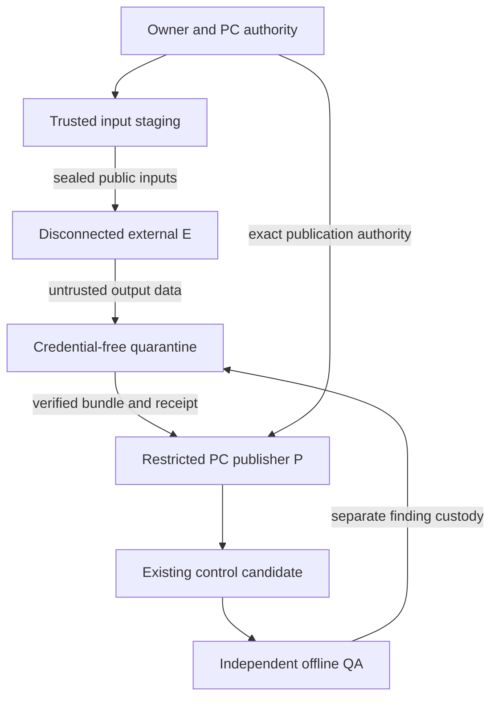
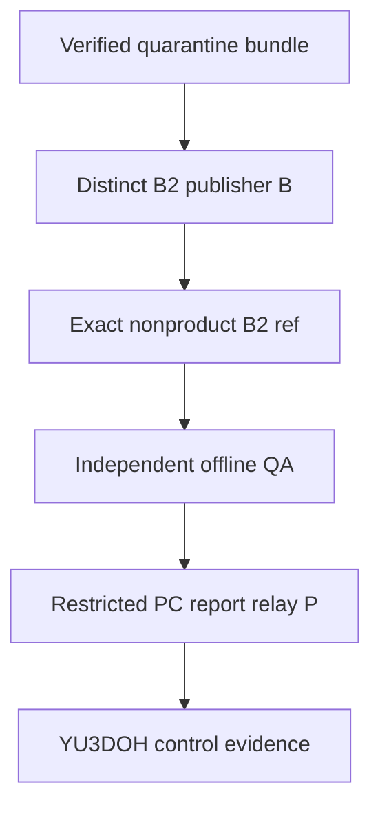

# PP-002 Q02 C2 — External Isolated Executor and Restricted Publisher
## Architecture design handoff

artifact_id: PP-002-Q02-C2-EXTERNAL-ISOLATION-DESIGN-HANDOFF
assignment: C2-EXT-DES-001
artifact_type: design_only / future_security_evidence_contract
status: DESIGN READY FOR PC-003 AND SEPARATELY ROUTED INDEPENDENT QA
author / design closer: PROTOCOL_PORTABILITY / PP-002
return_to: PROJECT_CONTROL / PC-003
repository: KhaosMagnus/YU3DOH-Carder
activation_control: 618a201a182ed909cac5effbab6a1d33350800f2
activation_tree: fe9f2ad0511c46d52e63e53dfce16547ee40b1f9
owner_approval: control/PP-002_Q02_C2_OWNER_DESIGN_APPROVAL.md
frozen_scope: control/PP-002_Q02_C2_EXTERNAL_ISOLATION_DESIGN_SCOPE.md
authorization: control/PP-002_Q02_C2_DESIGN_AUTHORIZATION.md
request: validations/PP-002/Q02-C2/PP-002_C2_EXTERNAL_ISOLATION_DESIGN_REQUEST.md
route: routing/ROUTE-PP-002-Q02-C2-PP-002-DESIGN.md
recommended_candidate: A1 / DISCONNECTED PHYSICAL EXECUTOR + GUARDED PC RELAY
actual_placement_selected: NO
infrastructure / publisher / credentials / security_configuration / tests: NONE CREATED OR EXECUTED
S1 / S2: NOT INDEPENDENTLY PROVEN
S3-S6: NOT EXECUTED
B1 / B2 implementation: NO-GO
Q02-PROT-001: NOT AUTHORIZED
Q01: INDEPENDENT OFFLINE PASS / UNCHANGED
F1: INDEPENDENT PAPER QA PASS / UNCHANGED
Option_I: INDEPENDENT EVIDENCE QUALITY PASS / UNCHANGED
Gate_C / final_PP-002: REVISE / UNCHANGED
P01 / P02: UNCERTAIN / UNKNOWN
Generic_Protocol_v1.0 / PP-002_v2: FROZEN / UNCHANGED
GOV-BRANCH-001: IMPORTANT / DEFERRED
protocol_successor / adoption / integration: NOT AUTHORIZED

## 1. Recommendation and the decisions still required

**Recommend A1 as the narrow design candidate for the first offline Q02
prototype:** a separately administered, physically disconnected execution machine
E; exact public/synthetic inputs; controlled transfer to an unprivileged
quarantine/review station; and PC-owned, technically guarded publication P after
data review. E has no GitHub identity, repository access, connected ChatGPT
session or callable publication route. No experimental GitHub repository or
experimental publisher B is required for E to compute offline mock results.

This is a recommendation for later Owner evaluation, not a placement choice,
procurement instruction, environment certification or execution GO. A1 is minimal
only if a suitable separate machine and trusted custody can be established.
They have not been identified or verified. The current connected authoring
context is not the proposed E or a qualified restricted P.

There are two material costs that an offline machine does not remove:

1. **Original YU3DOH S2 remains a hard pre-execution gate.** Effective official-ref
   protection, narrow legitimate PC continuity, complete bypass/alternate-writer
   evidence and independently justified qualification are still missing. Do not
   run the prototype first because the worker is disconnected or in B2.
2. **Durable candidate publication needs an explicit future location policy.**
   The recommended A1 completion path uses existing control for a bounded new
   source/evidence delivery, so that independent QA can consume an exact GitHub
   candidate SHA/tree. That needs a new exact Owner exception to the control
   branch's documentation-only policy, equivalent in specificity to the earlier
   Q01 authorization, not a blanket precedent. No such exception is authorized
   by C2. If Owner declines it, A1 may not publish code there; select a separately
   scoped A2/B2 alternative or DEFER. [GIT] [Q01-D]

**A2/B2 is the fallback** when a separate nonproduct code store is wanted, repeated
work makes offline artifact handling disproportionate, or Owner wants no new
code exception on control. B2 must have its own distinct, repository-limited
publisher B with no YU3DOH write grant and no selectable PC/admin fallback. It
does not replace the disconnected E or waive original S2. A second repository
using the same broad connection would preserve the central security defect.

The decisive next sequence is independent design QA, Owner candidate/location
decision, and a separately authorized nonsecret identity/host/custody preflight.
Do not provision a machine, token, repository, publisher or rule under this
document. Do not commission more AI-support paraphrases to manufacture an
unavailable per-conversation guarantee.

## 2. Source-bound observations and limits

### What is observed

Twenty exact source artifacts were freshly retrieved at activation and their
raw Git blob identities recomputed against the complete nontruncated tree.
Appendix A provides paths, blobs and retrieval clocks. That tree contains 1811
blobs / 1940 entries, no AGENTS.md and an absent handoff output path.

[C1] directs that ordinary ChatGPT conversation/role separation is not an
accepted technical ACL for this connected writer. Its basis includes three
Owner-forwarded AI-assisted support responses and public documentation. [C1-S]
expressly lacks a support-ticket identity, provider-signed claim, per-call issuer
proof or actual runtime policy. This supports excluding per-chat isolation as
an engineering dependency; it does not establish universal impossibility in
every product, authenticate this plugin's signer or qualify another environment.

[I-QA] accepts Option I intake quality, including independently checked byte
hashes and classification. ID-01/03/07/08 remain UNKNOWN; ID-02/04/05/06 PARTIAL.
Procedurally independent review did not prove different GitHub principals.
[F1-QA] accepts paper design and preserves M01/M02 plus L01. None of these
acceptances is S1/S2 proof, a host assessment or an installed publisher.

The earlier login/admin metadata, installation 162412374 selection=all and
plugin usage setting are historical observations in [I]/[I-QA]/[C1-S], not fresh
token or policy attestations in this design. A tool namespace and app confirmation
preference are not principal/credential/context enforcement evidence.

Fresh reads here were confined to immutable sources and publication/preservation
state: control resolved to the supplied activation; the branch collection
returned 47 entries with protected=false, followed by an empty second page;
tag matching refs returned []. Their clocks and protected checkpoint heads are
in Appendix B. Returned branch flags do not prove all classic/inherited rules,
actual bypasses or off-platform restrictions. Rulesets, installations and token
rights were not re-polled in C2; prior empty ruleset responses stay historical.

### What is proposed or unknown

All E/staging/quarantine/publisher/runtime/issuer controls below are PROPOSED.
Actual hardware, OS/runtime versions, network adapters, App/principal IDs,
credential subset, storage, publisher implementation, policy fingerprints,
independent security verifier and qualification results are UNKNOWN. No actual
isolation guarantee follows from a diagram or a clean-image plan.

The runtime skill was read for the authoring environment. Its environment-status
tool was unavailable and its nonsecret network-policy snapshot was absent;
neither fact establishes confinement, credential absence or egress denial. No
credential inspection, network/host test, canary, container or prototype execution
was used. Source hashing/document preparation is not Q02/V execution.

Definitions throughout: OBSERVED is a stated source receipt; INFERENCE is a
reasoned conclusion from it; PROPOSED is a future requirement; UNKNOWN is absent
evidence; BLOCK means the affected action may not proceed. No planned state
becomes observed state. A later result is reconciliation evidence, not proof
available at an earlier checkpoint.

## 3. Actors, authority and trust boundaries

Actor labels are functions, not existing principal IDs. No App or issuer is
created by naming one. A small operation can combine trusted human duties, but
must document the combined trust and retain an independent verifier/QA author.

| Actor | Proposed responsibility and trust | Capability boundary / actual status |
|---|---|---|
| Owner / A-G | Approves candidate/location and later exact configuration; separately held settings/emergency custody | Never accessible to E or experimental B. Actual recovery channel and grants UNKNOWN. |
| PC-003 / P | Freezes authority and relays approved artifacts through an independently accepted restricted publisher | Exact C-only publication service/operation, no candidate execution, no arbitrary signer interface. Governance role known; technical P identity/guard UNKNOWN. |
| C0 / custody and issuer | Stages approved inputs; controls media/archives; where necessary coordinates independently restricted issuer and one-time provisioning | Distinguish custody person from GitHub App registration, installation and token. No credentials on E or quarantine. Actual identities/roles unassigned. |
| E | Untrusted offline prototype implementation/execution with standard-library mocks | No GitHub/network/connector, host privilege, PC browser, signing credentials or privileged fallback. Proposed external machine unverified. |
| V / quarantine reviewer | Treats outputs as untrusted data, verifies approved file inventory and public-data eligibility before any Git object creation | Credential-free reader station; no execution/import of candidate code; exact review receipt outside E. UNKNOWN. |
| Q / independent security verifier and later QA | Verifies actual S1/S2/S4 evidence; separately reproduces held exact candidate under S6 | Must be independent of implementation; separate explicit PC route and custody. Does not self-grant settings or security PASS. |
| B, A2 only | Publishes approved candidate/evidence on exact B2 ref D | Distinct principal/App from P; only B2 repository grant; credential unavailable to E/V; no YU3DOH write. UNKNOWN/unprovisioned. |
| U / legitimate integrators and other writers | Existing/future nonexperimental product operations under normal product authority | Complete real inventory/matching needed for S2 continuity; PP-002 grants no product/ref work. |

### Recommended A1 data and control boundary

The arrows are separately controlled transfer/authority events, not network
connections from E or a callable E-to-P API. There is deliberately no E-to-P,
E-to-Owner or E-to-connected-tool control edge. Human transport of a payload
does not authorize instructions embedded in it.

A1 has no experimental publisher B. P remains PC's trusted publication component
after independent data custody checks; E cannot select, invoke, renew or obtain
its credentials. This does not relabel an experimental writer as P or permit
sharing a P token with a different chat. Any later scope adding an autonomous
experimental uploader introduces B and must prove a distinct limited identity
and route. Independent security review must validate this actor/capability
composition against the unchanged S1, rather than certify it from labels.

### A2/B2 additions

E stays disconnected in A2. B2 is durable publication/custody, not a reason to
connect E. Q receives exact candidate bytes by controlled staging. P relays the
accepted independent result separately; a B2 commit is never merged into product
or control automatically.

## 4. Alternatives and proportionality

| Factor | A1: disconnected E, existing PC custody/publication | A2: disconnected E plus independently permissioned B2 | B1 inside YU3DOH, counterfactual only |
|---|---|---|---|
| Execution isolation | Physical external E, no live repo or writer needed | Same E requirement | A branch does not isolate a connected executor |
| Routine writers | Guarded P outside E; no B | Guarded P plus distinct B/issuer | Distinct B in product repository plus P; larger same-repo bearer exposure |
| Raw bearer exposure | P is an explicit trusted PC root; cannot be available to E/V | B compromise limited by target repository grant if no alternate YU3DOH route | B's Contents grant can reach original-repo APIs outside the ref/path broker |
| Candidate source custody | Exact future bounded code/evidence delivery on existing C requires a new Owner policy exception; sealed local copies before publication | Dedicated D gives native GitHub code/evidence storage; create repo/ref/grants separately | N1 catalog and experimental ref need separate approval/configuration |
| Original S2 | Mandatory and currently unproven | Equally mandatory; sandbox isolation does not protect original refs | Mandatory, with additional B-to-official-ref denial and W/K qualification |
| Product continuity | No experimental branch writer/catalog needed; original S2 still needs legitimate P/U paths and bounded staging | Avoids adding B2 exceptions to original product writer catalog; original S2 remains | M01/M02 catalog, lifecycle and cross-writer burden is most direct |
| Recovery | Sealed manifests + custody checkpoints + exact candidate/ref receipts; manual media discipline | Same plus separate B2 operation journal and cross-repo return bindings | More original-ref concurrency/permission interactions |
| Owner burden | Host/custody/publisher proof and a precise location exception | Same host/custody plus repo/App/issuer/grant/retention governance | Host/custody plus same-repo experiment and wider permission coordination |
| Best fit | One small offline rehearsal with suitable separate hardware and controlled manual transfers | Repeated tooling work or Owner rejects code on control | Not recommended as a way around missing platform isolation |

A1's advantage is fewer experimental networked actors/resources, not proven
zero risk or removal of S2. A2's advantage is isolation of B's repository grant
and clean code custody, not universal isolation from an all-repositories App.
Neither changes the actual requirement for a trusted P/issuer/quarantine chain.

### Concrete candidate and location recommendation

Recommend A1 with a dedicated disconnected physical machine, rather than a VM
on the active privileged PC workstation, for the first design candidate. A VM
on a separately administered credential-free host can be considered only under
an independently reviewed host/hypervisor policy. A container or disconnected
guest on a host retaining PC credentials is not accepted by assumption: host
services, shared folders/clipboard, management sockets and the hypervisor remain
part of its trusted boundary. NIST treats hypervisor resource mediation/isolation
as security responsibilities, not automatic properties certified by a VM name.
[NIST]

For completed A1 candidate custody, propose a new narrowly named Owner allowance
for only the final frozen new Q02 source/evidence paths on C, with P preserving
all predecessor bytes. Earlier Q01 code there is not blanket permission. This
keeps exact GitHub SHA/tree QA possible without creating an experimental remote
repository. No prototype execution on the publication host and no product merge
are part of the proposal. If the exception is rejected, A2 becomes the recommended
alternative; do not publish source as a disguised Markdown attachment or call
an unpublished archive a GitHub candidate.

Before that location decision, offline outputs can only be proposed custody
artifacts under separately authorized storage. A local bundle digest/native
tree is not a published accepted GitHub SHA. The code/location policy issue is
a gate, not an implementation detail postponed until upload.

## 5. Threat model and hard isolation requirements

In scope: accidental wrong/default refs or paths; untrusted candidate/fixture
code trying to obtain PC capability; ambient secrets or network inheritance;
compromised/misrouted inputs; archive/path escape or active-content outputs;
forged expected results or approvals; stale authority and custody; lost media,
interrupted execution or publication; duplicate effects; alternate raw writers;
partial rule deployment; and privileged recovery leaking into E.

Trusted roots: Owner/settings and physical custody, provider enforcement,
verified boot/runtime substrate and its administrator, staging/manifest anchor,
quarantine tools/reviewer, restricted publisher/issuer and independent verifier.
A malicious Owner, compromised firmware/provider, or a compromised entire trusted
publisher cannot be defeated by a role prompt. Declare these residual trust
assumptions and restrict their blast radius. No absolute proof of all possible
covert channels or secret absence is claimed.

| Requirement | Proposed actual technical control | Nonsecret proof / falsifiable failure |
|---|---|---|
| E-01 Separate outer substrate | Dedicated machine/account custody separate from P/Owner workstation; trusted installed OS and pinned Python 3.10+ standard library; unprivileged E | Independent hardware/host/image/version identification and admin/physical custody evidence. Shared privileged host/user/session without qualified boundary fails. |
| E-02 No writer identity | No App/PAT/OAuth session, browser login, key, Git credential helper, SSH agent, cloud identity binding or connected tool runtime on E; no copied PC home/profile | Independent build/provision policy and minimal image/mount inventory. Do not obtain proof by dumping real credential files or environment. Any unexplained credential channel blocks. |
| E-03 No egress or remote control | Disconnect Ethernet and disable/remove radios/cellular/tethering; no network adapter/bridge or remote management path during the run; OS deny policy as additional defense | Independently witnessed connection/interface/policy inventory and before/during/after custody. Network tests, if needed later, require safe separate qualification authority; no real provider probe now. |
| E-04 No host/connector inheritance | No MCP/connector client/socket, Docker/host management socket, clipboard/shared folder, live mount, USB network, executable remote-control agent or privileged exec service | Actual service/device/mount/IPC policy and explicit inherited/fallback route coverage. A Python audit hook or FakeTransport alone fails this obligation. |
| E-05 Bounded data and authority | Verified read-only input media/corpus and exact scratch output root; no package install/download, hooks or network-triggering job; independent resource limits | Approved file/mode/hash manifest and mount/access policy; unlisted writable mount, executable helper or external effect blocks. |
| E-06 No privilege recovery path | Restart/resume uses the same attested offline host/custody; unknown image/config invalidates prior GO; no transition into privileged chat, host or issuer | Durable restart policy, host/config fingerprint and accountable custodian. An emergency fallback with P/admin access invalidates S1/S4. |
| E-07 Independent continuity | Record nonsecret local checkpoints/run identity, external custodian custody and immutable output seals; after interruption reconcile before repeating | Q can distinguish proposed, actually issued and observed operations from surviving records. Missing telemetry remains UNKNOWN/UNCERTAIN. |
| E-08 Retention and quarantine | Output media/archives are untrusted until independent data checks; no autorun; no E data device attached directly to credential-bearing P without approved containment | Actual transfer/reviewer policy and positive custody evidence. A human approval click alone is not technical containment. |

No hardware, OS, network policy or mount was inspected/tested as an implementation
of these controls. A paper checklist becomes evidence only when it binds actual
identified settings/substrate and an independently attributable observer. Runtime
attestations need freshness and change invalidation; a screenshot before a later
configuration change is not continuous enforcement.

## 6. Input, output and immutable candidate custody

### Staging approved inputs without a live E connection

An authorized trusted staging actor outside E retrieves immutable GitHub sources
and membership evidence, then prepares a public-only export. Public source reads
do not require granting E a writer or any connection. E receives files, not
credentials, active download instructions or a PC-connected working directory.

Required input manifest: assignment/authority blobs and source CONTROL; exact
Q01 accepted candidate 328e57035d34f98c4d8d417729e8b12f91894e95; Q01 file pins;
frozen Q02 handoff/test contract; R1/C checker pins; all required historical raw
fixtures/membership; clearly synthetic fixture/oracle definitions; exact new
source allowlist when separately approved; runtime/dependency identity and
resource bounds. Pin repository/path/commit/tree/blob and actual byte lengths/
SHA-256. Tree membership and source acquisition must be independently anchored,
not derived solely from E's own manifest.

Copy only the bounded required public corpus, with all relative inputs needed
by F01–F31 and original historical adapters. No product database, Workspace
assets, private records, environment dump, signed URL, original .git/config,
hooks/credentials or hidden cache enters E. A reduced export is not the original
full Git tree: preserve original provenance and describe the reduced file set.
If an essential source cannot safely be staged, BLOCK the affected test rather
than redact it and claim exactness or silently skip the family.

Use verified read-only input media and a separately controlled output channel.
An offline transfer is not automatically one-way: media, filesystem parsers and
device firmware are trust boundaries. Prefer independently controlled read-only
or write-once exchange where practicable; if ordinary removable media is used,
its handling/inspection policy and residual bidirectional risk must be accepted.
No unknown E device is plugged straight into P's privileged host. No hardware
data diode, attested boot or air-gap certification is presumed available.

### Record chain, outside and inside E

| Record | Issuer / required binding | Recovery use |
|---|---|---|
| AuthoritySeed / InputSeal | PC authority plus independent staging custodian; exact pins, allowlists, storage/retention, host identity and closer | Establish durable scope/input; preparation time is not execution issuance |
| TransferReceipt / HostAcceptance | Sender and independent receiving custodian; source/destination media/host, safe inventory/digests, actual available receipt clocks | Resolve lost/duplicate imports by exact seal, not filename |
| ExecutionIntent / local checkpoint | E run ID plus external custody anchor; code/input/config versions, allowed scratch/effects, planned_intent separate | Intent is not proof dispatch/completion occurred |
| Invocation / response / effect records | Actual offline mock-call observations and crash-surviving journal; raw truth separate from recovery-visible subset | Classify only surviving facts; missing call/receipt timing is UNKNOWN |
| OutputSeal / QuarantineReceipt | E outputs plus independent V inventory/hash/type/secret eligibility checks; exclude no files silently | E assertions remain untrusted until corroborated; rejected output is quarantined, not accepted evidence |
| PublicationIntent / Approval | Trusted P side; exact safe bundle, authority, paths, parent, identity/grant/config fingerprints and independent V receipt | Authorizes only a bounded candidate/audit delivery; not functional QA PASS |
| PublicationReceipt / Verification | Actual remote operation/commit/tree/blob, acknowledged or reconciled effect, protected-ref readback, custody/retention and closer | Durable candidate exact SHA for independent QA; no second publication for a lost ACK |
| Independent QA receipt | Separately routed Q, exact candidate/source/fixtures and original oracles, new replay roots and measured counters | Acceptance is only for the exact candidate and stated offline scope |

Every material record separates actual requested_at, returned receipt_at/responded_at,
source event_at, recorded_at and verified_at. Label clock domains. Offline clocks
may be unsynchronized: do not invent UTC equivalence or order across hosts without
an anchored transfer relation. Use exact record IDs/hash links and explicit
UNKNOWN where source timing is absent. No assembly time replaces observation.

For deterministic replay, keep semantic canonical outputs separate from execution
timestamps/host metadata. Two fresh roots must produce byte-identical semantic
outputs for fixed fixtures/clocks; archive original source bytes independently.
A digest cannot prove who issued a record or an actual source request by itself.

### Quarantine and publication eligibility

V inspects the entire proposed bundle as data, using trusted tools/configuration,
without importing/running candidate Python, Git hooks, rendering active content
or following archive instructions. Validate exact allowed names/modes, normalized
paths, traversal/absolute paths, symlinks/gitlinks, nested archives, hard links,
device entries, size/count/resource limits, secret/signed-URL patterns and
unapproved identifiers. Reject or explicitly isolate unsafe content. Matching
one report hash does not approve extra files in its tree.

Data eligibility is checked **before** creating Git blobs/trees or any remote
upload: unreferenced Git objects can still be a public exposure. No actual
secret values are used as fixtures/canaries. A projected/redacted extract is
labeled as such, never claimed to be original raw bytes. If required raw custody
cannot be retained safely under the approved storage, record UNKNOWN/BLOCK and
request separate private custody authority; no secret artifact is published.

Default future retention keeps sealed input, original candidate/output and
independent QA/failed-attempt evidence with at least two independently checked
custody copies until PC closes retention. Exact medium/location/access/lifetime
must be approved; two directories on the same transient disk do not supply
independent custody. Reconstruct a lost copy from a verified identical seal;
if bytes or identity differ, quarantine as another candidate, never overwrite.

### Candidate identities and A1 publication on existing C

Before E execution, future S3 freezes the exact new source file inventory under
the proposed Q02 source root and separate evidence/report paths. These remain
proposals from [Q02], not effective writes now. After output data checks, P
uses only these proposed location roots if the later Owner scope approves them:

- `validation/pp002-q02-control-integration/` for the explicitly enumerated new
  prototype sources and labeled synthetic fixtures;
- `validations/PP-002/Q02-CONTROL-INTEGRATION/Q02-PROT-001/` for bounded new evidence;
- `implementations/PP-002_Q02_OFFLINE_PROTOTYPE_REPORT.md` for the candidate report.

Exact filenames, generated-name grammar, file counts/bytes, runtime/memory/disk/
duration ceilings and invocation/retry budget must be frozen before execution;
no wildcard or absent limit is an execution grant. All previous Q01/checker/
evidence bytes and central indexes are outside that implementation allowlist.
After the data checks and effective location approval, P
reconstructs a candidate tree from approved files and the verified current
control parent, preserving every predecessor path/mode/blob outside the new
allowlist. P does not import E's Git config, hooks, remotes or caller-supplied
extra parents. Source code is stored as data; it is executed only on the
separately qualified offline implementation/QA machines.

The resulting actual GitHub candidate SHA/tree, rather than E's filename or
archive hash alone, is frozen for S6. Publishing an explicitly unaccepted
candidate for QA requires its own authority and is distinct from accepting it.
Later PC/QA documentation may advance C while Q pins the original candidate.
Any source correction creates a new candidate/QA disposition, not a rewrite
of accepted evidence. No source/evidence delivery is permitted unless Owner
has first issued the exact documentation-policy exception and bounded paths.

An A2 export/import likewise has a new B2 tree/commit identity. It retains
original Q01 source/member pins but is not relabeled as original candidate
328e57035d34f98c4d8d417729e8b12f91894e95.

## 7. Restricted publication, identity and least privilege

### Mandatory technical route outside E

The trusted publication boundary holds its bearer outside E and V, accepts a
fixed data-only envelope and verifies authority/independent review at use. A
human accepts the exact bundle, but technical checks and a closed capability
surface must prevent the human-facing caller/E from obtaining a generic signed
GitHub client. P does not execute natural-language instructions in reports,
choose an arbitrary endpoint supplied by E or expose its issuer/private key.

| Component | Proposed exact authority | Denied / proof obligation |
|---|---|---|
| A1 PC publisher P | Verified actual principal/App, target YU3DOH repo ID 1374186410, Metadata read/Contents write only; exact existing C and authorized new paths, additive single-parent publication | No Administration/Actions/Workflows/issues/PR/key grants. Broker denies release and arbitrary endpoint/ref operations despite the broader Contents capability. A fixed method is not a per-path token; actual issuer/broker/ref backstops need independent proof. |
| A2 publisher B | Different registration/principal from P; selected B2 repo numeric ID only, minimal Metadata/Contents; exact precreated D and allowed files | No YU3DOH write grant or alternate P/Owner connection; no repo/branch/tag creation, settings or workflow operations; no raw bearer exposed to E/V |
| C0 provisioning/issuer | Separate bounded future authority to create approved resources if needed; issue exact repository/permission subsets to fixed publisher workload | No credential string/log in handoffs; no on-demand arbitrary signing service; close provisioning duty and route at completion |
| Q | Read exact approved source/custody/configuration; actual independent role/identity as required by its route | No implementer self-approval, production write probe or unapproved privilege escalation |

### A2 target and server-side backstop proposal

The actual B2 repository ID/name/visibility and actor IDs are UNKNOWN. Proposed
candidate ref D is `refs/heads/experiment/q02-prot-001` in that separately scoped
nonproduct repository only; it is not a YU3DOH ref. Owner must freeze the actual
numeric target, source and default branch before any provisioning. Do not reuse
an all-repository PC App/connection merely because it can see the new repository.

| Proposed B2 rule group | Exact scope and effect | Bypass boundary |
|---|---|---|
| D0 history | All sandbox branches: deny non-fast-forward and deletion | NONE, independently separate from update permission |
| D1 default creation | All sandbox branches except exact D: restrict creation | NONE; no arbitrary caller-selected branch |
| D2 other updates | All sandbox branches except exact D: restrict updates | NONE; protects default and other sandbox refs |
| D3 candidate update | Exact D only: restrict updates, no upstream fetch/merge exception | Verified B App/principal only for this update group |
| D4 provisioning | Exact D only: restrict creation | Verified C0 only during explicit absent-ref/create-once window, closed after confirmed creation |
| D5 tags | Independently verified all-tag matching: deny creation/update/deletion | NONE; nested names/target support verified, not guessed |
| D6 held candidate | Exact D update restriction during separately authorized QA hold | NONE; a correction needs a new explicit candidate/hold disposition |

These are design groups, not installed or deployable JSON. Confirm actual
schema/feature/ref matching and full aggregation in independent qualification;
an update bypass must not bypass D0. B has no settings/creation permission exposed
by its broker, no secret access and no YU3DOH grant. Repository Contents still
requires route-level denial of releases, unrelated Git objects and extra API/ref
namespaces. Suppress automatic CI/Actions through an explicitly approved actual
repository policy and absence of workflow content; no workflow or setting is
changed here. Independent Q must inspect the resulting configuration. Sandbox
denials do not prove original YU3DOH S2 and do not authorize broader original
product/tag freezes. D0-D6 apply only to the dedicated future sandbox.

Installation selection, actual App registration, installation ID, authentication
mode and per-issued token repository/permission subset are separately recorded.
GitHub documents narrowing installation tokens and a one-hour lifetime; verify
actual subset/expiry and independent issuer custody rather than assuming defaults.
[GH-TOKEN] No App/token is minted or inspected here.

Nonsecret signer attestation must bind actual request ID, actor/App/installation,
auth mode, opaque credential handle, requested/effective grants/resource IDs,
issue/expiry/revocation, issuer/config version, payload/target and actual call
receipt. A Git commit author/signature, login response, token alias or PC role
does not prove that binding. Unknown request/wire data remains UNKNOWN.

Server branch/tag controls provide an independent backstop where applicable;
repo Contents grants are broader than specific ref/path writes. Public-repository
branch rules alone do not implement this file allowlist or deny every release/
Git object/extra-namespace API. Credential issuer and broker compromise remain
explicit trusted-root risks. Actual App IDs and bypass entries, never installation
IDs substituted for App IDs, must be reviewed and read back. [F1] [F1-QA]

### Prepublication decision order

P must independently verify, in this order:

1. Current valid exact authority, role/closer, approved phase/location and custody.
2. Actual signer/grants/route/runtime configuration still matches qualified pins;
   no enabled alternative broad writer accessible to the experimental actor.
3. Original S2 and target controls still valid; actual parent H, exact repo/ref,
   output path absence/collision and compatibility with the frozen task.
4. Exact safe bundle inventory, candidate source pins, whole-tree delta/parents/
   modes and data eligibility; Q01 profile and applicable checker composition.
5. Named human acceptance of those exact bytes/paths plus independent V receipt,
   and scoped publication purpose: CANDIDATE/AUDIT versus ACCEPTANCE decision.
6. Qualified expected-old update H to prepared N, force=false, single allowed
   ref and independent no-force/deletion protections; then remote verification.

Any material UNKNOWN/FAIL, expired authority/configuration or candidate change
invalidates approval and blocks the affected publication. Immutable historical
content may use Q01 EXACT_CONTENT with explicit state N/A; no fake state PASS.
Fresh operational/security decisions require attributable request history and
an independently applicable state checker. Original R1/C checkers remain
historical regression adapters, not live permission or publisher checkers.

Approved diagnostic custody may be retained as AUDIT_ONLY after a decision block
only under explicit scope; it does not become a successful current-state ledger.
Count custody writes separately from zero affected decision callbacks. Neither
Q01's offline guard nor a manual operator is an installed universal interceptor.

### CAS: available mechanism versus unverified implementation

The current connector exposes expected_sha, while GitHub REST ref-update
documentation exposes sha and force, not an expected-old body field. Therefore
strict atomic H-to-N comparison is a future transport qualification obligation;
an immediate read then unguarded write is insufficient. This design does not
claim that ordinary successful governance publication proves hidden atomicity.
[GH-REF]

A technically feasible future publisher can use a fixed reviewed transport
with server-checked expected-old ref semantics, plus independent fast-forward
and no-deletion checks. Git documents explicit expected-value lease semantics;
that is a mechanism reference, not approval to run a force-capable command or
switch the present tool to force=true. Any actual transport implementation,
Git/provider version and no-force behavior must be separately reviewed and
qualified in a disposable resource. Do not substitute stale remote-tracking
state or serializing only one client for server expected-old protection.
[GIT-PUSH]

Later qualification must distinguish: a changed remote head positively rejects;
normal exact-parent fast-forward succeeds; a competing authorized writer cannot
be overwritten; unknown accepted ACK is reconciled without duplicate effect;
no other ref is touched. If the actual supported route cannot meet these
guarantees, keep real publication BLOCKED and return the capability gap. The
offline prototype can model the contract but cannot qualify remote CAS.

### Alternate writer and fallback closure

Inventory connector/client/browser/other account routes, PAT/OAuth/SSH/deploy
keys, Git/Contents/GraphQL/merge/release APIs, Actions/GITHUB_TOKEN/services,
credential helpers, local/host sockets, environment mounts and emergency/issuer
channels. Record actual principal, grant, accessible context and evidence of
restriction. Do not infer absence from a clean control tree or one denied GET.
E/V have none of these routes; P/B expose only reviewed publication methods.
Owner emergency/configuration access remains separately trusted and audited,
never an experimental retry fallback. Unknown alternate capability blocks S1.

## 8. Original YU3DOH S2, continuity and F1 findings

**S2 is preserved verbatim in purpose:** actual control/product/checkpoint
protections, narrow bypasses and safe legitimate PC route must be independently
proved on the intended identities/substrate. Main, Serial/Carder and Workspace
checkpoints, control and relevant historical ops remain protected subjects in
the project sense; current returned flags do not establish enforcement.

An external E with no credentials removes its direct remote writer route; it
does not prevent other original-repo writers from changing refs or prove P's
guard. A2's B2-only grant limits B but does not satisfy original-ref S2. No
designer's N/A, accepted mock PASS or B2 placement can waive that requirement.
If actual evidence plus safely qualified disposable equivalents cannot support
independent S2 acceptance, both architectures remain execution NO-GO.

Use F1's CFG-00–10 exact future packet contract for any settings phase. Actual
before/after rules, complete bypass actors, classic/inherited coverage, exact
ref matching (including absent/nested names), issuer bindings, supported feature/
plan and drift fingerprints are required. Public reads can omit bypass details;
obtain safe attributable Owner views instead of treating a missing field as [].
[GH-RULES]

Do not install N0–N9 just to make this paper design seem concrete. A1 adds no
experimental B/X and may avoid some experiment-specific original-repo exceptions,
but the actual least-disruptive original S2 policy still needs its own exact
review/Owner decision. No rule JSON or wider admin bypass is approved here.

| Preserved finding | Binding future requirement |
|---|---|
| M01 — bounded legitimate continuity | Before security activation inventory legitimate PC/product/update/create/release/tag needs, named admission/repair owner, next already-authorized PC publication, maximum disruption window and delay budget. Obtain explicit accepted deferral or exact safe allowance; empty PRs are insufficient. Do not globally freeze unrelated work as a hidden prototype prerequisite. |
| M02 — W/K and cross-writer lifecycle | If the eventual policy uses W/K or equivalent exceptions, qualify U(r) positive, B/P/wrong-U denials, exact-k creation/name/source/principal checks, K-to-W transition, narrow-first admission/default-first removal, lost ACK/drift/overlap/nested names, independent force/delete restrictions and any authorized release allowance. Do not declare these cases passed or delete branches as a test. |
| L01 — tag source | The matching-refs tag route is usable for inventory; refresh at actual settings baseline time. Empty current tags do not prove all-tag matching or other namespace coverage; never project a later tag receipt backward into F1. |

For A2, absence of W/K in the B2 sandbox does not erase M01/M02 on any original
S2 configuration that uses such exceptions. If a future exact policy uses no
W/K, independent Q must explicitly map the non-applicability and equivalent
continuity/cross-writer coverage; it is not a blanket test omission.

Later staging must preserve control continuity: identify actual P and out-of-band
Owner recovery; qualify rules/transport in a separately authorized disposable
substrate; stop experimental activity during partial activation; install narrow
legitimate paths before removing default-deny coverage; read back every layer.
No priority ordering between rulesets overrides overlapping restrictive rules.
A legitimate already-authorized PC publication, never a fabricated test commit,
can later provide positive actual continuity evidence.

Any actual configuration needs explicit Owner approval for its exact deltas,
actors, target IDs, test substrate/effects, activation deadline, before/after
hashes, independent verifier and containment/rollback. No current C2 action
changes that policy. GOV-BRANCH-001 remains separate/deferred: the future
continuity requirement is not a branch-retirement assignment.

## 9. Full S1–S6 evidence and acceptance contract

All six gates retain the original Owner requirement. This table specifies
evidence and phase, not current acceptance. Real security qualification and
offline implementation/QA are separate duties and authorities.

| Gate / phase | Required actual evidence and oracle | A1 / A2 application | Present result / hard stop |
|---|---|---|---|
| S1 before prototype implementation/placement GO | Independent actual actor/App/installation/token/route map, issuer attestation and outer-context capability exclusions; alternate writer/restart/fallback coverage; actual intended principal/substrate qualification | A1 E/V cannot invoke or obtain P/Owner; no B exists. A2 additionally distinct B with B2-only rights and no P/YU3DOH alternate route. Verify capability composition, not role names. | NOT INDEPENDENTLY PROVEN. Missing actor/issuer/context/host proof BLOCKS. |
| S2 before prototype implementation/placement GO | Complete actual original YU3DOH protections/bypasses/ref matching/continuity and independent justified mapping to disposable behavior; intended actors, before/after/ref readbacks; original closer | Both retain main/Serial/Workspace/control/relevant ops protection. A2 adds sandbox target controls without replacing original S2. No real original-ref negative write probe. | NOT INDEPENDENTLY PROVEN. Offline E/B2/public metadata is not S2; no waiver. |
| S3 before source admission or any authorized target creation | Separate exact execution authority, immutable source/control SHA/tree, manifest, exact new file/mode/resource allowlist, frozen output location and absent/collision evidence | A1 selects existing C and absent new paths with explicit bounded code-policy exception; no remote branch creation required. A2 freezes exact numeric repo/ref D, approved source, absent/create-only target and one-time C0 authority. Exact candidate SHA/tree pinned after actual publication. | NOT EXECUTED. Location/exception/target/source fields missing => BLOCK; no automatic baseline substitution. |
| S4 before execution and throughout | Independently identified host/runtime/image, no-credential/network/connector/host-IPC enforcement, fresh policy/custody before/during/after and restart constraints; appropriately authorized safe qualification evidence | Same disconnected E in both. Separate independent QA host meets equivalent boundary. FakeTransport and Python hooks do not attest outer confinement. | NOT EXECUTED. Unknown network or ambient privilege => stop/quarantine, no privileged fallback. |
| S5 before input import/public upload and throughout | Approved public/synthetic data classes, exact source custody, credential-free transfer/quarantine, independent data-only inspections before object creation, storage/retention/incident evidence | A1 P publishes only safe exact inventory on C; A2 B on D then P summary. No raw secrets/signed URLs/private logs; unsafe required input blocks. | NOT EXECUTED. Missing safe custody => BLOCK; do not sanitize silently and claim exactness. |
| S6 after held candidate, before acceptance/integration | Separately routed independent Q on exact GitHub candidate SHA/tree, all I01–I32/subcases, Q01 F01–F31, unchanged R1/C regressions/negative controls, two-root semantic-byte identity, counters, custody, refs and limitations | A1 QA pins original published C candidate even as later docs advance. A2 QA pins exact D candidate and original provenance. No acceptance transferred to a corrected candidate. | NOT EXECUTED. S6 pending is not a startup waiver or a circular precondition before a candidate exists. |

For S1/S2, future independent acceptance needs actual configuration/identity
evidence plus behavior on separately authorized disposable equivalents where
necessary. Use the accepted V01–V20 contract and M02 subcases with exact intended
actors/resource-substitution manifest and functioning positive controls. An
expired token, malformed request or inaccessible repository is not the intended
ref denial. No real YU3DOH write-denial probe is proposed. If mapping cannot be
justified, return UNKNOWN/BLOCK and do not quietly lower the security gate.

V20 is conditional on B2 placement, not a current PASS. E host/media quarantine
proof is real infrastructure qualification, not Q02's fake permissions model.
Current C2 conducts none of these activities.

### Offline functional contract retained for S6

| Frozen families | What independent QA must preserve |
|---|---|
| I01–I08 | Exact content/history composition, prepared ACK, crash/issuance gaps, actual-versus-prepared clocks and distinct read-only recovery; no fabricated state PASS |
| I09–I16 | Correlation/ref/blob/membership/origin errors, R2 planned-path reconciliation, timestamp roles, forged producer/index limit, secret quarantine, checker applicability and full unchanged historical regressions |
| I17–I24 | Freshness and payload/tree/closer drift, compatible/incompatible concurrency, lost ACK versus rejected CAS, explicit unrestricted-writer bypass and accurately scoped restricted mock |
| I25–I32 | Turnover/outage/closer, independent v2 dimensions, stale/cross-assignment approvals, AUDIT_ONLY counts, every persistence/call/CAS crash boundary, two-root deterministic semantics, no self-reference and no permissive defaults |
| Q01 F01–F31 | All 31 original families and required subcases/profile checks; accepted source/corpus bytes and historical C-030/R2 defect oracles preserved |
| Original R1 / Gate C | Exact pinned unchanged scripts, original negative/positive fixtures and historical C-020/C-060 checks; historical adapter result never promoted to live permission/cleanup proof |

Full I definitions remain [Q02] section 13, not replaced by this grouping.
I13/I23 must expose hash-only authenticity and unrestricted mock bypass limits,
not hide them to make everything green. The independent oracle retains raw
truth that the recovering actor may not observe; post-hoc success must not
leak into earlier crash decisions. Record actual fake/real emissions, callbacks,
accepted CAS/effects, diagnostic custody writes, blocked decisions and skipped
cases honestly. A fake negative with zero callbacks is not native GitHub denial.

## 10. Recovery, idempotency, cleanup and terminal ownership

Every materially stateful custody/issuance/publication operation retains a named
closer. Record logical_operation_id, parent or NONE, type/purpose, authority and
CONTROL, host/code/input/candidate/harness as applicable, external operation ID
or explicit lost-ID, emission channel, exact output/effect namespace, retry/
idempotency characteristics, actual issuance/ACK and all source/time fields.
Planned intent is structurally distinct from observed state. Parent/child
records are independent: execution != export != quarantine != upload != QA.

Use the unchanged v2 axes: lifecycle CONFIRMED_DONE/CONFIRMED_NOT_DONE/
STILL_RUNNING/UNCERTAIN; outcome SUCCESS/FAILURE/CANCELLED/PARTIAL/UNKNOWN/
NOT_APPLICABLE; effect NO_EFFECT_CONFIRMED/EFFECT_CONFIRMED/POSSIBLE_EFFECT/
EFFECT_UNKNOWN/NOT_APPLICABLE; evidence EVIDENCE_VERIFIED/
EVIDENCE_AVAILABLE_UNVERIFIED/EVIDENCE_INACCESSIBLE/EVIDENCE_INSUFFICIENT/
NO_EVIDENCE_EXPECTED/UNKNOWN; cleanup CLEANUP_CONFIRMED/CLEANUP_REQUIRED/
CLEANUP_UNKNOWN/CLEANUP_NOT_APPLICABLE; acknowledgement NOT_EMITTED_CONFIRMED/
EMITTED_ACKNOWLEDGED/EMITTED_UNACKNOWLEDGED/UNKNOWN. DONE does not mean SUCCESS
or reusable evidence.

| Failure/uncertainty | Required recovery and safe action |
|---|---|
| Offline execution observed active, observer lost | Recover durable host/run/input identity and fresh bounded local observation under authority; STILL_RUNNING -> KEEP_OBSERVING. No duplicate run merely to regain confirmation. |
| Process completed during loss, exact output sealed | Reverify raw results/effects, code/input/host identity and custody. CONFIRMED_DONE + SUCCESS + sufficient verified evidence -> REUSE_RESULT; missed confirmation does not justify rerun. |
| Internal test failed but parent/finalizer active | Child DONE + FAILURE can coexist with parent STILL_RUNNING; RECONCILE_EFFECT for partial outputs, KEEP_OBSERVING parent. Runner exit alone does not prove application/output cleanup. |
| Checkpoint, ACK or media missing | UNKNOWN/UNCERTAIN emission/effect where unsupported; read/reconcile exact surviving records/seals. No filename-based reuse, automatic overwrite or blind repeat. BLOCK affected action if material uncertainty remains. |
| Duplicate import/output with same exact seal | Reuse retained verified bytes if authority/custody compatible; record duplicate transport separately. Same name/different seal is collision/new candidate and BLOCKS affected acceptance. |
| Local retry appears needed | First reconcile original lifecycle/effects/cleanup, remaining need, authority, exact source/candidate and namespace; prove isolation/idempotency, bounded resource rationale and original/retry closers. Only then separately authorized RETRY_JUSTIFIED; no in-place overwrite. |
| Credential/network/fallback leakage or host drift | Stop affected work; preserve safe evidence/quarantine output; invalidate S1/S4 and any dependent approval; use separately authorized external custodian containment, never copy P/admin access into E. |
| P/B response missing after possible ref update | Read exact candidate N/history/ref/output paths. If N is current or independently verified ancestor with exact bytes, reconcile original effect and REUSE_RESULT. Otherwise retain UNCERTAIN and BLOCK repeat until resolved. |
| Positively rejected expected-old update | Record actual rejected request, fresh H and original candidate separately. Inspect authority compatibility and path collisions before explicit reprepare allowed by policy; no force, deletion or blind replacement. |
| Read/configuration source unavailable | Continue safe unaffected read-only work only; affected publication/execution remains BLOCK. No private chat-memory terminal proof. |
| Original actor disappears or a late result arrives | PC assigns successor closer explicitly; original lifecycle/outcome/effect/evidence/cleanup/retention remain open until dispositioned. A successful replacement or QA run does not close the original. |

A prospective instruction "Continúa" means recover affected operations first,
then continue reconciled/unaffected work inside existing authority. It grants
no new host, network, credential, publication, retry/replacement or scope.
Sealed checkpoints enable successor recovery without private memory; missing
local telemetry stays UNKNOWN. This design does not retrospectively establish
P01/P02, real quota exhaustion recovery or involuntary executor-crash safety.

Cleanup/retention closure needs explicit evidence: scratch roots and partial
outputs enumerated; admitted evidence sealed/retained; unneeded sensitive output
isolated under authority; removable media/session mounts disconnected/read back;
temporary grants/issuer routes expired or explicitly revoked as authorized;
public candidate/evidence retained with a closer. Never delete evidence merely
to report a clean run. Physical disposal, branch/repo retirement or history
rewrite is a separate Owner action, not default cleanup. Public exposure may
persist in copies; deletion is not guaranteed erasure.

On partially installed future security settings: keep E/B stopped, read actual
configuration and before/after identity, reconcile the original operation,
repair only the approved narrow P/U path through separately held A/G. Preserve
no-force/deletion and original-ref protections. Rollback means containment or
return to an approved known-safe state, not return to empty/unprotected rules.
Never repeat uncertain settings creation just because its ACK was lost.

## 11. Staged future proposal and stop conditions

These are future gates, not tasks activated by this design. Each mutation,
infrastructure phase, qualification and implementation needs a new exact route.

| Stage | Proposed decision / required exit evidence |
|---|---|
| C2-DQ | Separately routed independent review of this exact handoff, source pins, A1/A2 comparison, feasibility and six-gate completeness; corrections append-only |
| Owner candidate/location | Select A1 versus A2 or DEFER. For A1 expressly approve/decline bounded future code/evidence exception on C; for A2 approve exact new nonproduct repository/identity design scope. No provision merely from selecting a paper preference. |
| Custody/identity/host preflight | Obtain actual nonsecret device/OS/runtime/custodian, issuer/principal/route and data-transfer/publisher policy evidence; missing facts remain STOP/UNKNOWN. No real secret request. |
| Security configuration/qualification authority | Owner approves exact filled packet, actors/target IDs/permissions/ref rules, safe disposable test effects, resources/window/rollback and independent verifier. Provision only what that later route allows; no prototype code execution. |
| Independent S1/S2 | Verify actual original YU3DOH controls/identity and target route, plus appropriately qualified actual host/publisher and disposable behavior mapping. No original-ref negative probe; failure to justify mapping => NO-GO. |
| Frozen S3 | Exact implementation/input/control baseline, allowed files, location/targets/absence, resource/effect limits, stage-specific closers and retention; compatible future code policy resolved before admission/creation |
| S4/S5 readiness and execution authority | Independently establish disconnected outer E and safe input/output custody before execution. Only a new exact Q02-PROT-001 implementation route may start approved offline code/mock tests. |
| Candidate delivery | V checks whole bundle before remote objects; P or B creates/verifies exact authorized candidate, no product merge. Freeze actual GitHub SHA/tree and archive safe original bytes. |
| Independent S6 | New QA route, independent offline host/reviewer, exact candidate and all frozen tests/counters; accepted functional evidence remains offline only |
| Later integration decision | Owner/PC separately consider any live publisher integration, protocol successor or adoption. No automatic transition from an offline PASS. |

S4 host capability qualification may be gathered before S1 acceptance because
it is evidence for the boundary, but prototype execution still waits for all
applicable prior gates. S6 occurs after candidate creation, not before it. A
separate infrastructure/security route does not authorize the prototype, and
prototype authority does not authorize new credentials or real permission tests.

Hard STOP/BLOCK conditions: missing independent actual actor/host/route proof;
any selectable privileged fallback; original protected-ref drift; missing full
S2/continuity approval; unsupported atomic transport; unsafe input/output or
unrecoverable operation identity; collision/missing custody; evidence mismatch;
unexpected credential/egress/host access; unbounded cleanup; expired or changed
authority/configuration; new target, second attempt or effect outside scope.
Read-only recovery can continue when safe; no automatic privilege escalation.

## 12. Risks, costs and decision sensitivity

No architecture was instantiated, benchmarked or priced. No hardware availability,
license cost or engineering productivity is asserted. Estimates assume one small
offline prototype, existing suitable separate hardware, public corpus, manual
qualified custody, reusable trusted tools and no new always-on broker service.
They exclude independently required original S2 remediation and Q02 code/QA work.

| Planning component | A1 estimate | A2/B2 estimate | Main uncertainty |
|---|---|---|---|
| Host/custody preparation and independent evidence | 8–20 person-hours | 8–20 person-hours | Suitable actual machine/OS, operator capability, independent verification |
| Data transfer/manifest/quarantine design and rehearsal | 4–10 person-hours | 4–10 person-hours | Corpus completeness, safe media/inspection tools; no rehearsal performed now |
| Restricted publisher/issuer evidence and qualification using existing accepted components | 8–20 person-hours | 10–24 person-hours | Existing guard/atomic route absent; if new implementation is required, this estimate does not apply |
| Additional location/governance setup | 2–6 person-hours for exact C code exception and candidate scope | 4–10 person-hours for repo/App/ref/grant/retention governance | Owner location preference, provider feature availability and cleanup duties |
| Recurring manual delivery, provisional | 0.5–2 hours per sealed release | 0.5–1.5 hours per release, plus grant/rule maintenance | Artifact volume and drift; not measured savings |

The indicative one-time totals are 22–56 person-hours A1 and 26–64 A2 under those
assumptions; ranges overlap and cannot establish a measured economic advantage.
New publisher development, absent hardware, external-provider delays, original
S2 changes or independent security work can dominate. Stop and re-estimate rather
than hide them inside a small offline implementation budget. Record actual actor/
grant counts, interventions, safe transfers, blocked attempts, recovery delay,
operator/QA time and custody/retention cost when later authorized.

| Residual risk | Consequence / mitigation / decision sensitivity |
|---|---|
| Compromised staging/manifest trust root | Consistent forged source/index may pass hashes; require independent original GitHub membership and separate custody. Q01 does not authenticate a forged source by itself. |
| Compromised E/firmware or unqualified shared host | Offline test results or data may be malicious; separate physical custody, restricted inputs, independent QA and quarantine; no assertion of perfect air-gap/host proof. |
| Transfer/media/parser compromise | Can bridge isolated and privileged zones; credential-free quarantine, no autorun/unknown device on P, trusted parsers/resource limits and explicit residual hardware trust. |
| P/issuer root compromise | May reach original control or other Contents APIs; actual narrow route/ref backstops and independent monitoring; Owner/settings/provider remain trusted roots. B2 limits B, not P. |
| Product continuity damage from S2 changes | M01/M02 and actual legitimate work/window required; do not impose blanket freeze or admin bypass to speed a prototype. |
| Control code-policy exception rejected | A1 cannot deliver sources on C under current policy; choose separately scoped A2 or DEFER. Do not disguise code or waive exact candidate QA. |
| Frequent large artifact flow | A1 custody cost can exceed A2 setup; measure actual workload and revisit placement under new authority. |
| Successful offline result overclaimed | Does not prove live CAS, real quota/crash/rollover, actual permissions or protocol adoption; retain Gate C/final REVISE and P01/P02 unknowns. |

Choose A2 at the later Owner decision if code on C is unacceptable, a limited B2
issuer already has credible evidence and repeated delivery justifies it, or
separating B's raw credential blast radius is required. If no actual host/issuer/
publisher evidence exists for either, the best-supported decision is DEFER/NO-GO,
not the more elaborate architecture by default.

## 13. Independent design QA acceptance contract

PC-003 must issue a separate independent reviewer/route after receiving this
handoff. This author does not activate QA or self-certify design/security PASS.
Paper design acceptance means the proposal is implementably specified and honest
about missing proof; actual infrastructure/security acceptance remains separate.

| Check | Required independent acceptance / rejection criterion |
|---|---|
| C2-Q01 Authority/source | Reproduce exact activation and all source blob/member pins; single additive allowed handoff; no coordinator/policy/product/ops changes |
| C2-Q02 C1 evidence boundary | Distinguish forwarded AI support/public docs from provider attestation; no ordinary-chat ACL dependency or unsupported universal-impossibility claim |
| C2-Q03 Alternatives/recommendation | Both no-new-repo A1 and genuinely restricted A2 considered; real source/candidate location issue and A1 policy exception explicit; no placement GO disguised as recommendation |
| C2-Q04 Actual outer E | Falsifiable no-credential/egress/connector/host-inheritance requirements, responsible custodian, evidence freshness and restart/fallback denial; no mock/hook/container-label substitute |
| C2-Q05 Principals/publisher | P/E/V/C0/Q/A-G/U and conditional B capabilities clear; E cannot call P/issuer; A2 B distinct and no original write grant; actual IDs/grants UNKNOWN rather than fabricated |
| C2-Q06 Data/candidate custody | Exact Q01/checker/corpus pins, public/synthetic data, trusted staging, malicious-output quarantine before Git objects, exact candidate SHA/tree and no original identity relabeling; no unsafe-media shortcut |
| C2-Q07 Fail-closed publication | Exact authority/source/path/tree/parent/profile/applicable state evidence at use, human plus technical guard, alternate writer closure; strict expected-old guarantee unverified until real qualification |
| C2-Q08 Original six gates | S1–S6 all traceable, original YU3DOH S2 unwaived in A2, S3 location/absence exact, S4/S5 prior to execution/upload, S6 after exact candidate with all frozen families |
| C2-Q09 Continuity/findings | M01/M02 future exact continuity/catalog tests and L01 timing retained; no broad original freeze without legitimate-work disposition; GOV-BRANCH separate and deferred |
| C2-Q10 Recovery | v2 lifecycle/outcome/effect/evidence/cleanup/ACK/closer independent; missing telemetry and lost ACK not failed/nonemitted; no blind retry, privileged fallback or closure by substitute |
| C2-Q11 Proportionality/stages | Costs labeled estimates with excluded shared S2/new-service work; design QA/Owner/preflight/security/config/S3/offline/S6/integration authority separated; concrete stops |
| C2-Q12 Claim/publication limits | No code/V/prototype, provisioning, secret capture, provider contact, config or branch-retirement action; preserved refs verified; exact candidate SHA/blob returned; no protocol promotion |

Reviewer must corroborate source facts from the exact revisions and inspect
mechanism sources as needed. It may reject ambiguity or require append-only
correction; it must not create missing host/issuer evidence by self-signing a
PASS or run forbidden probes to finish a paper review. No independently approved
design implies security configuration or Q02-PROT-001 execution permission.

## 14. Publication guard and terminal design finding

Only `handoffs/PP-002_Q02_C2_EXTERNAL_ISOLATION_DESIGN_HANDOFF.md` may be newly
published on existing meta/project-control. Before publication re-read current
head, confirm frozen authority unchanged and no incompatible requirement/path
collision, prepare an additive single-parent tree, preserve all predecessor
blobs/modes, use expected current head/CAS and force=false. A rejected lease
requires compatibility inspection before reprepare, never force or overwrite.
Postread exact commit/tree/handoff and preservation refs. Return actual candidate
CONTROL SHA/blob separately, avoiding self-referential future publication fields.
[CAS] [GIT]

**Terminal design result: DESIGN READY FOR PC-003 REVIEW AND SEPARATELY ROUTED
INDEPENDENT DESIGN QA.** Recommend A1 as the minimal conditional design candidate;
A2 is the explicitly compared fallback for location/credential-blast-radius or
repeated-work needs. No actual placement, policy exception, host, identity,
publisher, security proof or implementation was created/selected here.

S1/S2 NOT INDEPENDENTLY PROVEN; S3–S6 NOT EXECUTED. B1/B2 implementation NO-GO;
Q02-PROT-001 NOT AUTHORIZED. Q01 offline PASS, F1 paper QA PASS and Option I
evidence-quality PASS unchanged. Gate C/final PP-002 REVISE; P01 UNCERTAIN;
P02 UNKNOWN. Protocols frozen; no successor/adoption/integration. GOV-BRANCH-001
IMPORTANT/DEFERRED; Serial/Carder, Workspace, main/control and other relevant
refs remain preserved.

RETURN: PROTOCOL_PORTABILITY / PP-002 -> PROJECT_CONTROL / PC-003.

## Appendix A. Exact immutable source register

All twenty sources below were retrieved from KhaosMagnus/YU3DOH-Carder at exact activation `618a201a182ed909cac5effbab6a1d33350800f2`. Raw Git blob identities were recomputed and checked against the complete activation tree. Retrieval clocks are caller tool boundaries, not the historical events described inside the files.

| Label / pinned source | Git blob | requested_at / receipt_at UTC |
|---|---|---|
| [OWNER] [control/PP-002_Q02_C2_OWNER_DESIGN_APPROVAL.md](https://github.com/KhaosMagnus/YU3DOH-Carder/blob/618a201a182ed909cac5effbab6a1d33350800f2/control/PP-002_Q02_C2_OWNER_DESIGN_APPROVAL.md) | `13bf2fc7a25c1d0facd21c5d2841ab6ad0a380f5` | 2026-11-02T06:34:34.055Z / 2026-11-02T06:34:34.335Z |
| [SCOPE] [control/PP-002_Q02_C2_EXTERNAL_ISOLATION_DESIGN_SCOPE.md](https://github.com/KhaosMagnus/YU3DOH-Carder/blob/618a201a182ed909cac5effbab6a1d33350800f2/control/PP-002_Q02_C2_EXTERNAL_ISOLATION_DESIGN_SCOPE.md) | `ac23f6bdd160566baf838ca9fbafeb3d0c10b2bf` | 2026-11-02T06:34:34.055Z / 2026-11-02T06:34:34.342Z |
| [AUTH] [control/PP-002_Q02_C2_DESIGN_AUTHORIZATION.md](https://github.com/KhaosMagnus/YU3DOH-Carder/blob/618a201a182ed909cac5effbab6a1d33350800f2/control/PP-002_Q02_C2_DESIGN_AUTHORIZATION.md) | `62481fa83b6be3fdf203680f0b13594795f8d359` | 2026-11-02T06:34:34.055Z / 2026-11-02T06:34:34.312Z |
| [REQUEST] [validations/PP-002/Q02-C2/PP-002_C2_EXTERNAL_ISOLATION_DESIGN_REQUEST.md](https://github.com/KhaosMagnus/YU3DOH-Carder/blob/618a201a182ed909cac5effbab6a1d33350800f2/validations/PP-002/Q02-C2/PP-002_C2_EXTERNAL_ISOLATION_DESIGN_REQUEST.md) | `cc12a0593a50dc6ce450b078d2a37c0c44b27095` | 2026-11-02T06:34:34.055Z / 2026-11-02T06:34:34.408Z |
| [ROUTE] [routing/ROUTE-PP-002-Q02-C2-PP-002-DESIGN.md](https://github.com/KhaosMagnus/YU3DOH-Carder/blob/618a201a182ed909cac5effbab6a1d33350800f2/routing/ROUTE-PP-002-Q02-C2-PP-002-DESIGN.md) | `0cadeb9bf2beccb2bb934fdbb52dd612a34ada81` | 2026-11-02T06:34:34.055Z / 2026-11-02T06:34:34.491Z |
| [DECISION] [control/PP-002_Q02_C2_EXTERNAL_ISOLATION_DESIGN_OWNER_DECISION_REQUEST.md](https://github.com/KhaosMagnus/YU3DOH-Carder/blob/618a201a182ed909cac5effbab6a1d33350800f2/control/PP-002_Q02_C2_EXTERNAL_ISOLATION_DESIGN_OWNER_DECISION_REQUEST.md) | `a55acb5e26073596a2cb830f3a2bdddfb3d44a4b` | 2026-11-02T06:34:34.055Z / 2026-11-02T06:34:34.429Z |
| [C1] [runs/PP-002_Q02_C1_CONVERSATION_ISOLATION_DECISION_DISPOSITION.md](https://github.com/KhaosMagnus/YU3DOH-Carder/blob/618a201a182ed909cac5effbab6a1d33350800f2/runs/PP-002_Q02_C1_CONVERSATION_ISOLATION_DECISION_DISPOSITION.md) | `a74a261da0b7791da19e4bc0fa85baa4583699e2` | 2026-11-02T06:34:34.055Z / 2026-11-02T06:34:34.371Z |
| [F1] [handoffs/PP-002_Q02_F1_FEASIBILITY_AND_CONFIGURATION_CONTRACT.md](https://github.com/KhaosMagnus/YU3DOH-Carder/blob/618a201a182ed909cac5effbab6a1d33350800f2/handoffs/PP-002_Q02_F1_FEASIBILITY_AND_CONFIGURATION_CONTRACT.md) | `96b23062330006f59790883e87df4c095b37c5b2` | 2026-11-02T06:35:11.652Z / 2026-11-02T06:35:12.035Z |
| [F1-QA] [validations/PP-002/Q02-F1/DQA-008_INDEPENDENT_DESIGN_QA_REPORT.md](https://github.com/KhaosMagnus/YU3DOH-Carder/blob/618a201a182ed909cac5effbab6a1d33350800f2/validations/PP-002/Q02-F1/DQA-008_INDEPENDENT_DESIGN_QA_REPORT.md) | `c5c78b74d354ba14c5dfa364a07bc3cdcd751f98` | 2026-11-02T06:35:11.652Z / 2026-11-02T06:35:12.858Z |
| [I] [validations/PP-002/Q02-I/PP-002_IDENTITY_AND_ROUTE_EVIDENCE_REPORT.md](https://github.com/KhaosMagnus/YU3DOH-Carder/blob/618a201a182ed909cac5effbab6a1d33350800f2/validations/PP-002/Q02-I/PP-002_IDENTITY_AND_ROUTE_EVIDENCE_REPORT.md) | `2d6f3d1911adb3869f69be6bf754be4a7e55a7a2` | 2026-11-02T06:35:11.652Z / 2026-11-02T06:35:12.112Z |
| [I-QA] [validations/PP-002/Q02-I/DQA-009_INDEPENDENT_EVIDENCE_QA_REPORT.md](https://github.com/KhaosMagnus/YU3DOH-Carder/blob/618a201a182ed909cac5effbab6a1d33350800f2/validations/PP-002/Q02-I/DQA-009_INDEPENDENT_EVIDENCE_QA_REPORT.md) | `3399a48b75763e650d41f49b2e28fbc52942ca62` | 2026-11-02T06:35:11.652Z / 2026-11-02T06:35:11.990Z |
| [C1-S] [validations/PP-002/Q02-C1/C1_THIRD_AI_SUPPORT_REPLY_AND_PUBLIC_DOC_REVIEW.md](https://github.com/KhaosMagnus/YU3DOH-Carder/blob/618a201a182ed909cac5effbab6a1d33350800f2/validations/PP-002/Q02-C1/C1_THIRD_AI_SUPPORT_REPLY_AND_PUBLIC_DOC_REVIEW.md) | `dbe78566e09f962e0dd74a45df1409b1b0da81bc` | 2026-11-02T06:35:11.652Z / 2026-11-02T06:35:11.982Z |
| [Q02] [handoffs/PP-002_Q02_Q01_CONTROL_INTEGRATION_DESIGN_HANDOFF.md](https://github.com/KhaosMagnus/YU3DOH-Carder/blob/618a201a182ed909cac5effbab6a1d33350800f2/handoffs/PP-002_Q02_Q01_CONTROL_INTEGRATION_DESIGN_HANDOFF.md) | `a06fb711662848ccc16d2e32d621be279a9b1f4d` | 2026-11-02T06:35:11.652Z / 2026-11-02T06:35:11.978Z |
| [SIX] [control/PP-002_Q02_B1_OWNER_SIX_GATE_DECISION.md](https://github.com/KhaosMagnus/YU3DOH-Carder/blob/618a201a182ed909cac5effbab6a1d33350800f2/control/PP-002_Q02_B1_OWNER_SIX_GATE_DECISION.md) | `16c8ceecb50d59cb2e1d673e53dbaf1cf69610f5` | 2026-11-02T06:35:11.652Z / 2026-11-02T06:35:12.212Z |
| [V2] [control/PP-002_EXECUTION_INTERRUPTION_RECOVERY_PILOT-v2.md](https://github.com/KhaosMagnus/YU3DOH-Carder/blob/618a201a182ed909cac5effbab6a1d33350800f2/control/PP-002_EXECUTION_INTERRUPTION_RECOVERY_PILOT-v2.md) | `e9c0cfa89294202e8c499c11ad840d806fffae5e` | 2026-11-02T06:35:11.652Z / 2026-11-02T06:35:11.953Z |
| [Q01-D] [runs/PP-002_Q01_DQA-007_PASS_DISPOSITION.md](https://github.com/KhaosMagnus/YU3DOH-Carder/blob/618a201a182ed909cac5effbab6a1d33350800f2/runs/PP-002_Q01_DQA-007_PASS_DISPOSITION.md) | `4f2080c9b90dd4f3d7fcbc780d8b42da0c6d9ba3` | 2026-11-02T06:35:11.652Z / 2026-11-02T06:35:12.147Z |
| [CAS] [protocols/CONCURRENT_PUBLICATION_POLICY.md](https://github.com/KhaosMagnus/YU3DOH-Carder/blob/618a201a182ed909cac5effbab6a1d33350800f2/protocols/CONCURRENT_PUBLICATION_POLICY.md) | `9b7c4dfed7b25b98b61e73f342592359b846e490` | 2026-11-02T06:35:11.652Z / 2026-11-02T06:35:12.017Z |
| [GIT] [protocols/GIT_CONTROL_POLICY.md](https://github.com/KhaosMagnus/YU3DOH-Carder/blob/618a201a182ed909cac5effbab6a1d33350800f2/protocols/GIT_CONTROL_POLICY.md) | `8e00dd5ae7a153a09ce88c2614fbea2ce3f2393d` | 2026-11-02T06:35:11.652Z / 2026-11-02T06:35:11.984Z |
| [STATE] [PROJECT_STATE.md](https://github.com/KhaosMagnus/YU3DOH-Carder/blob/618a201a182ed909cac5effbab6a1d33350800f2/PROJECT_STATE.md) | `b3d240f682465d072e16c5c0d0719b3398d8624c` | 2026-11-02T06:35:11.652Z / 2026-11-02T06:35:11.989Z |
| [REG] [chats/CHAT_REGISTRY.md](https://github.com/KhaosMagnus/YU3DOH-Carder/blob/618a201a182ed909cac5effbab6a1d33350800f2/chats/CHAT_REGISTRY.md) | `ec0a0ed6e5b9e73e2001e81aed436a51c3d16c24` | 2026-11-02T06:35:11.652Z / 2026-11-02T06:35:12.017Z |

Unchanged source/checker pins independently located in the activation tree; these files were not executed:

| Path | Git blob |
|---|---|
| validation/pp002-gate-b-r1/revalidate.py | `e189cf780fbb0711fa442f342bec5d760bf4f3b1` |
| validation/pp002-gate-c/observer.py | `80591dd78b7aa414913e7a08767b0e6a2c7e5623` |
| validation/pp002-q01-collector/README.md | `ce02a0f3b53decd85799c478554a06fda85196b2` |
| validation/pp002-q01-collector/collector.py | `10d1407628539798ef93a2d354373eed3091fefd` |
| validation/pp002-q01-collector/guard.py | `e0394656cf4ba1034f09e6bf34ccc6c4b9ec52e0` |
| validation/pp002-q01-collector/run_contract.py | `c63b4fa72493da9d2b1b29446e7e24a223e5bbeb` |
| validation/pp002-q01-collector/test_guard.py | `d84329edf65a2557d0e3a2ff6ecdd398ffb3a906` |

These Q01 pins agree with the accepted implementation/disposition source; a future staging manifest must independently verify all candidate source/corpus membership at the original accepted revision. Current membership alone is not a substitute for that original acquisition.

## Appendix B. Fresh publication/preservation observations

These reads were solely documentary custody/ref preservation, not security qualification or branch-retirement analysis. UTC timestamps are caller requested/completed receipt boundaries. Event/wire times are UNKNOWN unless explicitly stated. Source hashes below identify exact returned UTF-8 content; full transient responses are not separately published under the single-handoff scope. Hashes plus summaries are not a provider-signed raw archive.

| Source / URL | requested_at UTC | receipt_at UTC | Result / returned-content SHA-256 |
|---|---|---|---|
| https://api.github.com/repos/KhaosMagnus/YU3DOH-Carder/git/ref/heads/meta/project-control | 2026-11-02T06:34:34.491Z | 2026-11-02T06:34:34.955Z | control head 618a201a182ed909cac5effbab6a1d33350800f2; `e1a4451c807cedc585a53eed36764f8f0d65ae484c5b92df0529d716a911fbd0` |
| https://api.github.com/repos/KhaosMagnus/YU3DOH-Carder/git/commits/618a201a182ed909cac5effbab6a1d33350800f2 | 2026-11-02T06:34:34.491Z | 2026-11-02T06:34:34.869Z | activation tree fe9f2ad0511c46d52e63e53dfce16547ee40b1f9; one parent afd3ae815afbdbac323cc50b79ec527aec903b0e; `68d37bad7f59aeeecebd84207b0905ecc55c043bdc4a55b71b191172f9d6279d` |
| https://api.github.com/repos/KhaosMagnus/YU3DOH-Carder/git/trees/fe9f2ad0511c46d52e63e53dfce16547ee40b1f9?recursive=1 | 2026-11-02T06:35:12.858Z | 2026-11-02T06:35:13.643Z | 1940 entries / 1811 blobs / truncated=false; `382ce2d40430b715835233ce0df7fba59ea4e6f2283fac9668281e3b63852314` |
| https://api.github.com/repos/KhaosMagnus/YU3DOH-Carder/branches?per_page=100&page=1 | 2026-11-02T06:35:12.858Z | 2026-11-02T06:35:13.240Z | 47 branches, protected=true count 0; `c8a5e479c42951e6dfcb4043aafe2fceb8b875d04878abfa5f121ee666836e43` |
| https://api.github.com/repos/KhaosMagnus/YU3DOH-Carder/branches?per_page=100&page=2 | 2026-11-02T06:35:12.858Z | 2026-11-02T06:35:13.266Z | empty second branch page; `4f53cda18c2baa0c0354bb5f9a3ecbe5ed12ab4d8e11ba873c2f11161202b945` |
| https://api.github.com/repos/KhaosMagnus/YU3DOH-Carder/git/matching-refs/tags/ | 2026-11-02T06:35:12.858Z | 2026-11-02T06:35:13.247Z | empty matching tags; `4f53cda18c2baa0c0354bb5f9a3ecbe5ed12ab4d8e11ba873c2f11161202b945` |

Activation commit author/committer event timestamp 2026-11-02T06:15:17Z is not its retrieval time or an authenticated REST signer. Source event time and caller observation time remain distinct.

Required preservation subjects, observed in the fresh first branch page:

| Ref | SHA |
|---|---|
| main | `54cc3aad246c89a29f2a18be63c539db68cae041` |
| feature/serial-v0.1 | `85dcd2f90090ff7da0589c9cf2ae3a4688d35455` |
| feature/workspace-v0.1 | `e11579950ef7ed20e4b6eeee88f9c3597c1f074b` |
| feature/workspace-run-026 | `e11579950ef7ed20e4b6eeee88f9c3597c1f074b` |
| meta/project-control | `618a201a182ed909cac5effbab6a1d33350800f2` |
| ops/pp-002-gate-b-actions | `dd6e8bfecadab0a83c8008ea65300b1f0ba518f8` |
| ops/pp-002-gate-b-r2-actions | `0e679ad863076098d92d8a7704f6ca88948b651b` |
| ops/pp-002-gate-c-actions | `9c508d06e3862b4b142e998708026a5ed8757fd0` |

All 47 returned refs must be preserved, except the explicitly authorized additive control handoff publication. The experimental branch was absent in this inventory. No deletion candidate, historical reachability or retirement classification is made. The observation is not an atomic multi-ref snapshot and does not exclude external concurrent changes. Final publication readback must compare the full before/after returned vector.

## Appendix C. Primary mechanism references and scope

Reviewed 2026-11-02 UTC / America/Mexico_City. Vendor documentation is mutable; future executable packets must pin and refresh the exact supported schema/version. These references describe mechanisms, not actual available hardware, token rights, publisher guarantees or S1/S2 acceptance. No command, credential example or qualification test was run.

- [NIST — SP 800-125A Rev. 1, server-based hypervisor responsibilities](https://csrc.nist.gov/pubs/sp/800/125/a/r1/final)
- [GH-TOKEN — Installation-token resource/permission subsets and lifetime](https://docs.github.com/en/apps/creating-github-apps/authenticating-with-a-github-app/generating-an-installation-access-token-for-a-github-app)
- [GH-REF — Git references and documented ref-update parameters](https://docs.github.com/en/rest/git/refs)
- [GH-RULES — Effective rules, conditions and bypass visibility](https://docs.github.com/en/rest/repos/rules)
- [GIT-PUSH — Explicit expected-value lease semantics](https://git-scm.com/docs/git-push)

NIST server-hypervisor guidance identifies isolation/mediation responsibilities; it does not certify a desktop VM, this proposed machine or a physically disconnected process. C1 platform claims are used only through the frozen, qualified source/disposition; their AI-support limitations are not replaced by a new provider guarantee here.

DESIGN READY FOR INDEPENDENT REVIEW / NO PLACEMENT OR IMPLEMENTATION GO.
