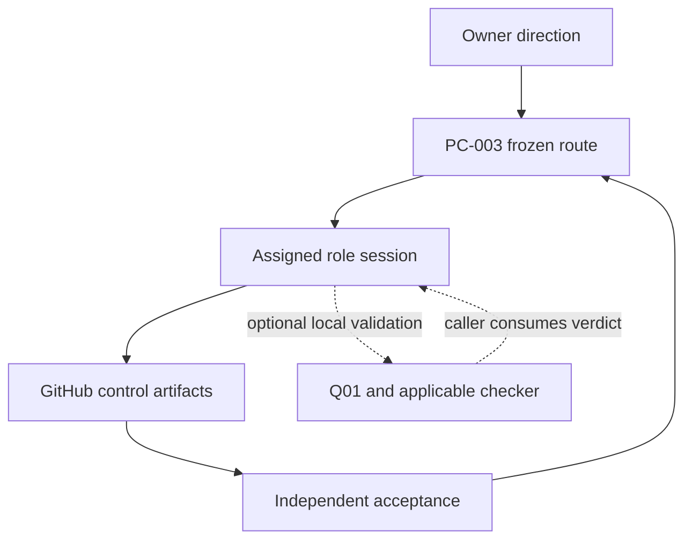
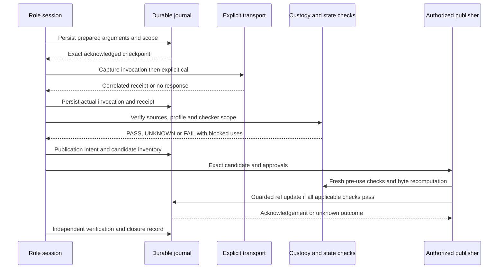

# PP-002 Q02 — Q01 Project Control Integration Architecture
## Design handoff and resilience closure readiness

artifact_id: PP-002-Q02-Q01-CONTROL-INTEGRATION-DESIGN-HANDOFF
assignment: Q02-DES-001
artifact_type: offline_architecture_design
status: DESIGN READY FOR PC-003 REVIEW
author / design closer: PROTOCOL_PORTABILITY / PP-002
recipient: PROJECT_CONTROL / PC-003
repository: KhaosMagnus/YU3DOH-Carder
activation_control: effafbb6ccfde69bc03722c5aaa08fb3eda62774
coordinator_design_baseline: 24566ded661eb225017bf407a0219e479afc397b
owner_direction: control/PP-002_Q02_OWNER_DESIGN_APPROVAL.md
primary_authorization: control/PP-002_Q02_Q01_INTEGRATION_DESIGN_AUTHORIZATION.md
frozen_scope: control/PP-002_Q02_Q01_INTEGRATION_DESIGN_SCOPE.md
primary_route: routing/ROUTE-PP-002-Q02-Q01-INTEGRATION-DESIGN.md
validated_Q01_candidate: 328e57035d34f98c4d8d417729e8b12f91894e95
validated_Q01_design_blob: c72e0a6d0889ceee4e901126a33587072180017f
official_Q01_QA: PASS / INDEPENDENT / OFFLINE ONLY
implementation / integration / live_test: NOT PERFORMED / NOT AUTHORIZED
official_Gate_C: REVISE / UNCHANGED
official_final_PP-002: REVISE / UNCHANGED
P01: UNCERTAIN
P02: UNKNOWN
Generic_Protocol_v1.0 / PP-002_v2: FROZEN / UNCHANGED
protocol_successor / adoption: NOT AUTHORIZED

## 1. Recommended decision

Accept this design for a separately scoped OFFLINE integration prototype.
Select an operator-assisted, source-bound prepublication gate as the minimum
practical integration target, preceded by a mock rehearsal of explicit capture,
durable journaling, restart and publication. Keep mandatory publisher enforcement
as a later, permission-dependent option.

Three assurances must remain distinct:

1. The accepted Q01 guard checks a supplied, pinned evidence bundle.
2. An explicit caller can collect and persist the evidence before using that guard.
3. An enforced writer prevents every in-scope publication that bypasses the checks.

Only the first has independent acceptance today. The second is technically
composable from normal tools but is not installed or proven as an end-to-end
integration. The third requires a controlled writer/permission boundary not
established by this repository or current tool metadata. [Q01-D] [QA] [CAPTURE]
[GUARD] [SCOPE]

The practical first release should cover exact historical/content evidence in
new control artifacts under an explicit allowed scope. It must BLOCK new
execution-state decisions without an applicable state checker and fresh source
history. It must not silently expand the frozen R1/Gate C adapters to new
workflows or call a caller-supplied PASS an independent operational verdict.

The design is ready for review; live universal enforcement remains DEPENDENT /
UNVERIFIED. That dependency does not prevent the bounded offline prototype.
No code, schema, fixture, new instance or prototype is created by this handoff.

## 2. Source-bound as-is inventory

### Evidence and authority

OBSERVED EVIDENCE: Q01's five delivered source blobs at the activation control
match their exact independently validated candidate tree. DQA-007's report and
PC-003's disposition accept the bounded offline contract: F01–F31, four reviewer
semantic replays matching 590055 bytes, 19 additional checks, and unchanged
R1/Gate C regressions. This design consumes that acceptance; it does not rerun
or count another independent execution. [QA] [Q01-D]

The actual project workflow is role/chat driven: Owner direction is recorded by
PC-003 in frozen scope/authorization/route artifacts; assigned roles read those
exact revisions, prepare role-owned outputs, publish additively, return an exact
transfer envelope, and PC-003 alone updates central indexes. GitHub is the durable
control store; conversation is a working/transfer interface. PC-003 succession
does not create a new PP instance or prove a platform session boundary. [LOCAL]
[COMM] [PC-ROLE] [ROLES] [SUCCESSION] [STATE] [REG]

The local Git control policy describes a documentation-only control branch.
Later specific Q01 authorizations/dispositions explicitly delivered experimental
validation code there; this is not evidence of a general permission to add an
operational service or amend that policy. Q02 authorizes one design file only.
A future prototype needs its own explicit allowed source/evidence paths and
resolution of the applicable control-branch policy. [GIT] [AUTH] [Q01-D]

### Actual surfaces versus proposed surfaces

| Surface | Evidence / current capability | Limit relevant to integration |
|---|---|---|
| Owner and PC-003 chat handoff | Frozen direction, scope, route, central state/registry and exact transfer revision | Role/session labels are assignments, not independently authenticated platform identities |
| GitHub connector fetch_file | Explicit repository_full_name, path, ref; content, returned blob and display URL | Call/response boundary is observable by caller; no original HTTP-wire timestamp or universal interception is exposed |
| GitHub connector fetch | Approved GET URLs, including immutable commits/trees/refs and Actions read subresources | Endpoint vocabulary, pagination and completeness must be checked; no assumption that any convenience wrapper is exhaustive |
| GitHub create_tree/create_commit/update_ref | Tree content, parent/tree pins; update_ref exposes expected_sha and force | Direct writer remains callable outside Q01; current metadata does not prove privilege restriction or server-wide policy enforcement |
| Code Mode orchestration | Explicit sequential tool calls can capture arguments and local invocation/receipt boundaries | Volatile state is not a durable journal; no advertised global hook, signed execution-cell trace or credential isolation between every caller |
| Python Q01 collector | Pure capture_request / ingest_response, copying arguments with injected clock | No durable persistence, transport, invocation interception or publisher |
| Python Q01 guard | Pure validation/approval; supplied state-check binding and fake injected callback | Does not authenticate a malicious source index, discover delegation, execute an independent state checker or prove all publishers use it |
| R1/Gate C scripts | Pinned historical receipt adapters, local regression commands, exact source vocabulary | Not a general checker for current future control operations |
| Bootstrap package builder | Rebuilds a pinned ZIP/manifest locally | Not an always-on dispatcher, capture service or publisher; it was inspected, not executed |
| Dedicated restricted publisher / durable platform audit | No installed implementation or complete permission inventory was established in this review | UNVERIFIED; separate capability evidence and Owner authority required |

The complete activation tree has 1742 blobs and no AGENTS.md. Its executable
path inventory contains bootstrap/test/validation tools and retained harness
copies, not an installed general connector interception service. No
.github/workflows file exists in this control tree; historical workflow harnesses
reside at their separate operational refs. This inventory does not prove that
no external platform service exists elsewhere. None is available as an
established dependency here. [BOOT] [ADAPTER] [Q01-README] [RUNNER] [CAPTURE]
[GUARD]; capability evidence is identified in section 18.

As-is flow, with the direct-write bypass visible:

INFERENCE: a required checklist can improve accountable operation, but it cannot
technically stop a privileged caller from taking the direct S-to-G path.
Making the optional arrow a mandatory software boundary requires more than
placing a guard script in the repository.

## 3. Alternatives and selected MVP

| Option | Feasibility now, subject to future authorization | Fidelity / custody | Enforcement and security | Cost and rollback |
|---|---|---|---|---|
| M — Manual/operator-assisted prepublication bundle check | Available Python guard plus explicit GitHub reads and human/chat handoff; no new host hook assumed | Exact content is feasible; exact request history only when an actual invocation capture/receipt survives | Procedural gate; writer can bypass. Independent review can detect many custody errors, not prove absence of omitted calls | Lowest new infrastructure; operator preparation remains measurable. Suspend route and retain records to roll back |
| W — Explicit connector-call capture bridge | Sequential opt-in Code Mode calls are composable; a version-pinned bridge and durable journal remain to be implemented/validated | Persist intended arguments before dispatch; capture actual invocation/receipt separately. Crash windows remain explicit | Improves in-scope capture; cannot intercept calls outside it or prove platform-level isolation | More records/commits and a narrow bootstrap trust root; resume from journal, never erase it |
| P — Separately authorized restricted publisher | CONDITIONAL / not established in this environment | Can re-read authority, source pins, policy, state-check result and exact prepared payload at the final boundary | Nonbypassable only inside a proven permission boundary: other principals/tools cannot update the governed ref or approvals | Highest administration/security burden. Revoke/suspend route or writer credential under separate authority; no rollback force-push |
| Global automatic host/plugin interceptor | No advertised hook or verified deployment substrate | Could offer stronger capture if independently attested | UNVERIFIED, not a dependency or current proposal to install | BLOCK automated goal until actual platform capability is evidenced |

Selected architecture: M as the initial scoped operating mode, W's sequence as
the target collection contract, first implemented only with injected mock
transport/store/publisher. Do not install a cosmetic wrapper and call it enforced.
P is optional later work; it is essential before claiming mandatory enforcement
against other privileged writers.

An operator may use EXACT_CONTENT for a historical artifact with explicitly
limited claims; missing original issuance history remains UNKNOWN. For a fresh
execution-state decision, M does not relax W's evidence needs: exact history,
freshness and an applicable operation checker are required or the decision is
BLOCKED. Thus a useful content MVP need not wait for unavailable platform
session telemetry, but it cannot certify interruption recovery generally.

## 4. Module reuse and future additions

Reuse Q01 at candidate 328e57035d34f98c4d8d417729e8b12f91894e95:

- collector.capture_request and ingest_response for actual caller-bound captures;
- guard.validate_bundle and approve with unchanged schemas, origins and exits;
- the existing fake use_if_approved boundary as an offline regression/reference,
  only where its explicit state-check precondition is genuinely satisfied;
- all original F01–F31 and independent Q01 acceptance evidence unchanged.

The function use_if_approved accepts expected_authority and state_check from its
caller. It compares them; it does not obtain authoritative delegation or execute
a checker. Q02 must add those duties outside the frozen guard. In a content-only
artifact with no operation-state assertion, the new outer composition records
NOT_APPLICABLE and uses validate_bundle/approve directly; it must not pass a
fabricated state_check PASS into the old fake wrapper. [GUARD] [QA]

Q01's exact URL profiles cover immutable GitHub file retrieval, not every API
endpoint. A direct current-ref or Actions run query is not an exact blob-file
URL accepted by parse_locator. Retaining such a receipt in a Git file and later
validating that file's retrieval proves the file's custody, not the original
query's freshness/history. Those original endpoint semantics, dispatch/receipt
clocks and subject bindings remain duties of the separately scoped capture and
operation-state adapter. The initial content MVP does not add endpoint support;
unsupported fresh-operation use is BLOCKED pending the necessary authorization
and independently accepted adapter. Control-store helper reads remain in the
explicit bootstrap/root coverage, not silently counted as Q01-validated queries.

Proposed additions for a separately authorized offline assignment, NOT created:

| Proposed boundary | Responsibility |
|---|---|
| policy adapter | Resolve pinned authority, actual allowed paths/methods/subjects, profile, closer and freshness requirements |
| journal adapter | Injected immutable object store, acknowledged checkpoints, namespace reservations and recovery reads |
| capture bridge | Prepared request versus real invocation boundary, exact argument equality, correlation and raw receipt retention |
| composition adapter | Bind Q01 result, checker execution receipt and decision claim type; reject unsupported checker scope |
| publisher model | Fake callback only; rehash exact candidate tree/payload, expected HEAD and authority at use; CAS model |
| recovery reader | Reopen acknowledged records, reconcile issued/unknown work and assign explicit next action |
| integration tests / schema documentation | Deterministic clock/store/transport mocks, crash injection, bypass proof, independent oracles |

A proposed source root is validation/pp002-q02-control-integration/ and proposed
evidence root validations/PP-002/Q02-CONTROL-INTEGRATION/<assignment>/**.
These names are recommendations, not new permissions or assigned instances.
No original path is overwritten. A real host bridge, writer service, credential
change or new operational-state adapter requires another explicit scope and
acceptance decision. If frozen checker semantics must change, stop for a
separately authorized versioned successor, not an in-place patch.

## 5. Prospective policy and trust seed

Before any future in-scope transport or publication, the authorizing authority
must freeze a policy with no permissive defaults:

- project/repository and exact authority revision/artifact blobs; approved Q01
  code pins, integration code/config pins, designated actor/closer and purpose;
- allowed read operations/endpoints and exact identity rules; first MVP uses
  immutable UTF-8 source retrieval and separately declared current-ref reads;
- allowed new output paths, exact planned filenames, namespace and immutable
  correction rule; central indexes remain PC-owned;
- allowed writer/ref, required expected-head/non-destructive mechanics and all
  protected refs; product and historical operational refs are denied;
- claim class CONTENT_EVIDENCE, HISTORICAL_OPERATION_REPLAY or
  FRESH_OPERATION_DECISION; applicable profile/checker or explicit N/A;
- source trust/retention/redaction policy and bootstrap checkpoint permission;
- current-state max_receipt_age, pre-use recheck window, clock uncertainty rule
  and required subject/isolation checks. Missing required timing policy BLOCKS
  fresh-state use; no numerical production threshold is invented here;
- resource/deadline bounds, exceptional recovery authority and blocker route.

These are future configuration fields, not new PP-002 lifecycle values.
The current design grant is not such an operating policy.

Bootstrap is explicit: initial authority/custody reads and the journal's own
checkpoint commits cannot recursively depend on a checkpoint of every helper
call. A future scope must designate that small trust root: approved authority
intake, immutable-store/CAS helper and its raw acknowledgements, separately
reviewed and fully inventoried. It must state that coverage is scoped material
decision-source retrievals and decision publication, not every platform call.
No exemption is silently extended to product mutations, Actions or arbitrary
tool calls.

Seed recovery uses the repository, frozen assignment revision, journal namespace
and logical IDs from the route. Scratch files, Code Mode store variables, the
predecessor's memory and unretained promises are NON-INHERITED. A successful
journal write needs a positive acknowledgement and exact object/publication
identity, not just a local file or the existence of an intended filename.

## 6. Immutable record contract

The following are proposed administrative record types, not replacements for
the frozen v2 operation ledger. Each carries schema/version, record_id, preceding
record IDs, assignment/role/closer, authority refs, subject namespace, content
digests and field-level source provenance. Append corrections; never overwrite.

| Record | Essential fields / interpretation |
|---|---|
| AuthoritySeed | Frozen scope/route/approval blobs, policy and code pins, protected refs, allowed purposes/paths, actor assignment and closer; source of trust and limits |
| PreparedBatch | Unique retrieval IDs; exact explicit arguments and tool name/version; declared purpose/profile; prepared_at; planned output namespace; DOES NOT assert dispatch |
| PersistReceipt | Journal method, expected-before ref, prepared object/tree/commit IDs, persistence call requested_at/receipt_at, positive acknowledgement, actual store locator; its clocks describe persistence only |
| InvocationCapture | Existing Q01 capture shape at the actual target call boundary; retrieval_id, exact explicit arguments, actual requested_at, wrapper/cell code claim and any available attributable execution evidence |
| ResponseCapture | Same retrieval/correlation IDs, original structured tool response, actual receipt_at; responded_at only a declared receipt alias; actual returned locator/blob, raw content byte source and completeness limitations |
| MembershipCapture | Explicit immutable tree request identity, raw complete response, selected commit/path/blob, retrieval clocks and trust source; no guessed branch resolution |
| AcquisitionIndex | Exact request/response/content/membership source IDs and byte pins, capture origins, unknowns, sensitivity classification and materialization mapping into unchanged Q01 schema |
| StateCheckReceipt | Checker/config/input/result pins, applicability/subject IDs, execution record, receipt freshness and dimensions; or explicit N/A with no state claim |
| PublicationIntent | Publication ID, exact intended paths and payload hashes, allowed ref/method, preceding authority/source/decision records, original closer, expected predecessor and resolution method |
| CompositeApproval | Q01 bundle/result/profile, state-check receipt or N/A, authority validity, closer, code/config, freshness decision, exact payload inventory and expected publication HEAD |
| PublicationReceipt | Prepared commit/tree, parent, expected ref, actual update request/acknowledgement, remote observations and unknowns; no future commit represented as previously observed |
| VerificationAndClosure | Actual path/blob/ancestry/ref verification, other refs, retention, anomalies, current operation dimensions and named terminal closer; separate source clocks from assembly/verification |

Every known field cites its supporting source or deterministic transformation.
Request arguments, returned identities, intended paths and authority revision
are separate fields. Unknown original values remain UNKNOWN. A role label or
code digest is not a signed identity/execution attestation.

Raw file content retains exact bytes before parsing; a canonical capture envelope
is identified as the retained structured tool record, not original HTTP bytes.
A derived display URL is never a transmitted URL claim. Capture of signed URLs,
tokens, credentials or authorization headers in Git is prohibited. The initial
scope should avoid them through an allowed structured-argument interface. If a
material secret-bearing source cannot be safely retained, BLOCK that evidence use
or separately approve an appropriate private store; never silently redact and
claim the redacted bytes are the original source.

## 7. Sequence and the unavoidable crash windows

### Separate preparation from invocation

The existing collector stamps requested_at when capture_request is called.
If that function is called, then a journal commit takes time, then the transport
starts, its timestamp is a preparation clock, not the target invocation clock.
This is an integration timing constraint, not a retroactive reversal of Q01's
offline PASS. [CAPTURE] [QA]

Required sequence:

1. Resolve AuthoritySeed and valid allowed scope. Prepare exact target arguments.
2. Persist PreparedBatch and obtain/verify its durable acknowledgement. Store
   prepared_at and persistence clocks. No target call yet.
3. Immediately before the target tool call, capture a Q01-shaped invocation using
   actual caller boundary clock; require byte/semantic equality of its explicit
   arguments with the acknowledged prepared entry. Invoke only that call with
   that correlation ID. No queueing delay may be called an invocation timestamp.
4. On response, record actual receipt boundary and ingest_response; preserve raw
   response/content and returned identities. Persist InvocationCapture and
   ResponseCapture as separate exact source files, possibly in one batch commit.
5. Collect required immutable membership with the same scoped discipline,
   materialize the source-bound bundle and validate Q01 before dependent use.

The host binding must be explicit. Python does not have the Code Mode plugin's
tools object. In a shared Python injected-transport mock, capture_request can
run directly at the call boundary. A future Code Mode bridge instead captures
the actual host timestamp/arguments immediately around its awaited tool call,
then materializes that original host event through the pinned Python adapter.
Replaying the captured clock into the pure helper is record assembly, not a
new invocation or original timing proof by itself. Preserve the original event
and its stated trust source; never substitute the time of a later Python call.
No claim that the host executed an exact published wrapper is independently
attested unless a real platform execution record establishes it.

The preparation commit is durable before dispatch; the actual invocation capture
may still be volatile until its receipt checkpoint. A crash between 3 and 4 can
lose that capture/receipt. No documented interface makes a remote connector call
and a Git journal commit one atomic operation. In that window, issued state and
original source timing can be UNCERTAIN/UNKNOWN. Prepared arguments alone cannot
authorize EXACT_REQUEST_HISTORY or prove nonemission.

The design deliberately preserves this gap. A trusted transport-side durable log
could reduce it, but no such hook is established here. A newly authorized read-only
observation may obtain a new receipt under a NEW retrieval ID; it does not recover
the missing history of the old call. A stateful operation or publication with
uncertain effect is reconciled, never blindly repeated.

Target sequence (future design only):

An acknowledgement arrow is required positive evidence, not an assumption that
the remote action will respond. An observer that disappears keeps its original
closer obligation until PC-003 explicitly reassigns it.

## 8. Profile and operation-state composition

The new outer gate verifies authority, provenance, applicability and publication
scope independently. It does not grant a new mutation merely because a Q01
result says PASS.

| Intended use | Q01 requirement | Operation-state requirement | Permitted conclusion |
|---|---|---|---|
| Immutable historical content quotation/review, no new execution-state assertion | EXACT_CONTENT PASS with all unknowns/limits retained | N/A explicitly justified by claim type | Use exact content only; no freshness or issuer-history claim |
| Replay of original R1/Gate C observations | Appropriate verified custody plus original declared historical timing | Original unchanged adapter on its exact historical contract; result pinned and labeled historical | Historical model result, not current external state |
| Fresh operation decision/publication | EXACT_REQUEST_HISTORY PASS, current authority and applicable freshness/isolation policy | Independently executed, applicable checker on exact operations/subjects/sources with verified receipt times, all dimensions and closer | Only the justified v2 action, not generic permission |
| Missing/unknown material source or required checker | UNKNOWN, FAIL, invalid input or out-of-scope checker | Insufficient | BLOCK affected decision/publication; archive diagnostic separately |
| Clean content artifact with old checker wrapper demanding PASS anyway | Do not manufacture a PASS | Explicit N/A in new composition; do not invoke the old fake callback as if a checker ran | New outer content policy or BLOCK until authorized |

R1 and Gate C adapters pin original controls, branches, manifest roles and step
vocabularies. Their regression PASS is not an applicable live checker for a new
workflow or administrative publisher. For the offline prototype, exercise them
against retained historical inputs only. Synthetic current-state composition
tests use a clearly labeled mock checker and prove gate wiring, not a new
operational checker.

If later scope requires a new real operation type, an additional separately
authorized adapter must establish its source semantics and acceptance. No changes
to the original checker source or v2 state vocabulary are implied. [R1] [C-CHECK]

StateCheckReceipt must bind checker source/config digests, actual input manifest,
raw source IDs, subject/control/product/harness where applicable, logical/external
operation IDs, result bytes, execution record and applicable freshness. The outer
gate must independently validate those facts and recheck authority/closer at use;
copying a result=PASS dictionary and a matching bundle hash is insufficient.

Lifecycle, outcome, effect, evidence, cleanup and acknowledgement remain separate.
CONFIRMED_DONE is not SUCCESS; a failed child does not close a running parent.
An accepted substitute does not close the original. Q01 cannot promote runner
termination into cleanup proof or evidence accessibility into QA acceptance. [V2]

A source clock ages while checking/publishing. Claims state the actual as-of
receipt, not eternal currentness. No cross-system transaction binds mutable
external workflow state atomically to a Git commit. If an intended action needs
that stronger guarantee, require an independently supported subject token/isolation
mechanism or BLOCK; do not invent an atomic snapshot.

## 9. Fail-closed decision and publication boundary

A CompositeApproval is valid only for exact purpose, profile, authority artifact
and currently compatible delegation, closer, validator/code/config pins, source
bytes and clocks, checker receipt/applicability, payload content and actual
filenames, expected control HEAD, allowed namespace and method.

The publisher must reconstruct those checks from pinned inputs at use. A stale
file, renamed output, new dependency, changed closer/delegation, expired receipt,
changed policy/code, or different target ref invalidates it. Current-head movement
does not automatically revoke the frozen task authority; it invalidates the
prepared publication binding and triggers compatibility inspection/repreparation,
not a CONTROL-SHA fallback into request history. [CONC]

Publishing raw FAIL/UNKNOWN evidence as an explicitly labeled AUDIT_ONLY record
can be separately allowed; it is not an approved decision ledger. Count journal/
audit writes separately from blocked decision publication. A failed gate produces
zero affected decision-publisher callbacks, not necessarily zero already
authorized custody writes.

Avoid self-reference: the payload inventory excludes its own digest record and
approval bytes; CompositeApproval pins the intended payloads, input/results,
authority and expected parent, not its own containing future commit SHA.
A prepared commit can be created and subsequently verified as a prepared object,
then used by the publisher. Its identity is observed from that creation receipt,
not embedded as an already-published fact in itself. Final publication receipt
and postverification are appended separately.

Administrative records excluded from a self-referential digest are still
enumerated by exact path/kind and freshly recomputed or independently validated.
Exclusion from a hash cycle is not exclusion from tree/scope validation.

A future publisher must verify the actual prepared tree, including extra files,
against the permitted inventory. Matching one report hash is insufficient if the
same commit also changes a central index or workflow. Deny additions/deletions/
mode changes outside scope and preserve all frozen predecessor paths/blobs.
The actual target filename participates in validation, preventing the R2 class
from being dismissed as a harmless digest match.

### CAS and recovery of publication

A publication batch should durably reserve its output namespace/ID and inventory
in PublicationIntent before an affected ref call. That record's acknowledged
containing commit becomes the candidate's expected parent. It cannot embed its
own commit SHA before creation. A successor can recover it by its route-bound
ID/path, actual Git history/first-addition and immutable acknowledgement; a
mutable path alone is not an identity.

Prepare the candidate against verified current head H. Require an expected-head
conditional H-to-N update with force=false and non-destructive ancestry checks.
Current connector metadata offers expected_sha; the bootstrap adapter requires
an actual atomic expected-old-value guard. A read-then-unguarded-write is
unacceptable. The offline mock can prove intended behavior, not remote atomicity
or hidden connector implementation. Separately verify that capability/race
behavior before claiming real enforced integration. [ADAPTER] [CONC]

On a positively rejected CAS, inspect current head, original candidate and exact
output paths. Rebuild only after proving authority compatibility, unchanged
effect need, prior attempt disposition and no collision, as allowed by the
concurrent-publication policy. This is not permission for automatic replacement
of UNCERTAIN work. A missing CAS response instead requires read-only reconciliation:

- N is current head or a verified ancestor and its exact output/payload is
  present: reconcile the original successful effect; no duplicate publication.
- Another commit already occupies the path: compare exact authority/bytes/history,
  do not overwrite or call it equivalent solely by filename.
- N is not observed and identity/acknowledgement remains missing: UNCERTAIN;
  absence from one current tree is not proof of no earlier publication.
- No safe identity/effect resolution: BLOCK the affected repeat and route to PC.

Prepared but unreferenced Git objects are not publication success and must not
be treated as a durable successor entry point. Terminal verification records
remote head/ancestry, exact outputs, all protected refs, any compatible later
advance and retention/closer. It cannot freeze all external facts forever.
CAS protects control history within the verified writer boundary; it does not
make source truth, credentials, cleanup and remote execution atomic.

## 10. Failure, restart and collision decision table

Administrative stages below describe records; operation lifecycle/action fields
remain the frozen v2 enums. Unknown is a valid safe result.

| Break or mismatch | What can be established | Safe next step / affected block |
|---|---|---|
| PreparedBatch not positively persisted | No trusted durable dispatch prerequisite | BLOCK target dispatch; inspect store. No claim target was not issued if an earlier caller may already have acted |
| Persistence accepted but its acknowledgement lost | Journal effect uncertain | Read by stable ID/path/history; reconcile original write, no blind second commit |
| Crash after prepared acknowledgement, before a recorded call | Intent exists; actual dispatch may still be unknown | Recover journal and actual receipts; no CONFIRMED_NOT_DONE from silence |
| Call may have occurred; invocation/receipt not persisted | Original request history/time and effect may be unknown | UNKNOWN/UNCERTAIN; BLOCK affected stateful repeat, obtain authorized observations |
| Response missing or swapped | No complete matched receipt, or positive correlation contradiction | UNKNOWN or FAIL; no replacement/automatic retry |
| Mutable/default ref | Literal source selection is known or missing, immutable identity not proven | Preserve it; BLOCK exact-history use. New exact read needs valid read authority and new ID |
| Same bytes at wrong commit | Content can match but attribution contradicts | FAIL affected provenance; explicit append-only correction, no ref alias |
| R2 intended/actual path mismatch | Administrative locator deviation | BLOCK affected use until exact scoped reconciliation; no state-axis rewrite |
| Source index forged/untrusted | Hashes can be internally consistent without authentic source | BLOCK trust-dependent approval; independent source/actor attestation or explicitly narrower trusted-producer scope |
| Missing source timing | Content may be exact, original observation boundary absent | EXACT_CONTENT only if independently valid; fresh decision BLOCKED |
| Stale authority, closer, subject, code, payload or approval | Prior approval is not the current intended use | Reobserve/revalidate inside authority or BLOCK; no approval reuse |
| Concurrent CAS rejection | That request is terminally rejected, not proof all related publication work is closed | Inspect original and new head; reprepare only if policy permits and all affected effects are reconciled |
| CAS success with lost response | Ref effect potentially completed | Read-only reconciliation of exact original candidate/history; no second update merely to obtain confirmation |
| Namespace/output collision | Another owner/artifact may exist | BLOCK affected publication; PC disposition, preserve both histories |
| Actor/session turnover | Durable assignment and journal may be recovered | Read custody first, identify inherited/NON-INHERITED facts; closer explicitly retained/reassigned |
| Repository/connector inaccessible | Cannot freshly establish required state/authority | BLOCK mutation/publication; safe read-only fallback only under existing explicit policy, later reconcile |
| Capture hook absent | No universal in-call interception proven | Use explicit opt-in path or declare automation unavailable; never synthesize execution telemetry |
| Direct privileged write bypass | Guard may not have been consulted | Manual mode: record uncovered publication and route audit; enforced mode: deployment NO-GO until denial is proven |
| Gate fails after some custody writes | Source/journal may exist, decision not approved | Keep AUDIT_ONLY evidence; zero affected decision callback; original closer reconciles any already emitted operations |
| Partial evidence/cleanup after an issued operation | Parent/child and cleanup dimensions can differ | RECONCILE_EFFECT / KEEP_OBSERVING / BLOCK as evidence supports, retain original closer |

For a permitted read-only retrieval, another fresh query can be a distinct
observation under existing scope. It never proves the earlier query failed or
repairs its missing issuance history. The content MVP grants no stateful external
operation, cancellation or parallel execution.

## 11. Human roles, handoffs and terminal ownership

No role/instance is activated by this design. Future responsibility boundaries:

| Function | Duty | Cannot substitute for |
|---|---|---|
| Owner | Approve actual integration/policy scope, privileges, exceptions and eventual successor/adoption | Missing technical telemetry or a retrospective Gate C PASS |
| PC-003 | Freeze routes/policy/permissions, maintain central indexes, assign closer/reviewer, disposition conflicts and terminal results | Implementation or independent QA evidence |
| PP-002 / assigned architect | Explain contract, limits and compatibility; return this handoff | Starting development/QA or revising frozen semantics |
| Separately assigned implementer | New bounded adapters, mock evidence, exact code pins and implementation report | Self-acceptance or live installation |
| Separately assigned DESIGN_QA | Independent raw-fact oracles, full offline reproduction, bypass and restart checks | Owner authorization or credential enforcement |
| Separately authorized integration administrator / operator | Verify exact accepted candidate and permitted target, install/use only within explicit scope, verify before/after | Creating new feature/scope or changing historical ops refs |
| Current operation closer | Reconcile every emitted operation, applicable effect/evidence/cleanup/retention, late outcomes | A substitute's success or predecessor silence |

Operator workflow: recover seed and authority; prepare/acknowledge the request
batch; invoke/capture; persist receipts and source bytes; validate profile/checker;
persist publication intent and stage exact payload; recheck and conditionally
publish; verify/close and emit return envelope. Independent review/acceptance is
a separate step where the route requires it, not an automatic hidden callback.

Across a chat interruption, use the namespace and exact durable checkpoint in
the transfer, current authoritative route/state, receipt history, original
operation IDs and closer. Do not rely on copied private reasoning. A new session
designation proves assignment only. PC-003 must reassign closure if the executor
cannot continue; accepted alternate evidence never abandons the original.

"Continúa" under valid scope means recover affected operations first, then
continue only reconciled/unaffected work. It is not a new mutation, replacement
or integration delegation. Read-only recovery within existing authority needs no
extra Owner prompt. Unresolved effect locks apply only to the affected namespace/
subject; unrelated work may continue when authority and isolation are proven.
[V2]

A durable reservation is not a global lock service. Multiple actors can race;
CAS and collision inspection remain required. Local lock files and conversational
claims confer no distributed exclusivity. Do not add automatic expiration that
silently frees an uncertain effect namespace.

## 12. Trust, privacy and bypass boundaries

| Claim | Required supporting boundary | Residual limit |
|---|---|---|
| Request really used these arguments | Actual caller-bound capture, same correlation/argument bytes and attributed transport log where available | A self-written envelope does not prove execution; hostile producer can forge records |
| Response and membership correspond | Retained connector receipt, exact URL/ref/path/blob and completeness, independent reread where required | Q01 is not a cryptographic remote-attestation or full Git-Merkle proof |
| Correct time semantics | Actual local invocation/receipt capture and explicit clock/source pointer; source event separate | No invented server clock, synchronized-host clock or lost original timestamp |
| Right actor/delegation | Frozen Owner/PC assignment and separately verified writer identity/permissions | Role text is not platform conversation ID or a complete activity trace |
| Code/version used | Immutable code/config pins and attributable execution record | A declared cell digest alone does not prove that exact cell was executed |
| Authentic source index | Independently pinned/approved index, constrained producer or reviewer checks | Signing a forged bundle afterward proves custody, not truth |
| Publication gate cannot be bypassed | Proven sole writer path/permissions for governed ref and allowed emergency path | Current direct connector writes remain a bypass; actor policy alone is not prevention |
| Safe secrets/retention | Allowed data classes, no secret headers/credentials; private store only if separately authorized; expiry and closer | Redaction cannot masquerade as original raw evidence; public Git is not a secret vault |

A restricted publisher must deny caller-supplied arbitrary tools, paths, refs,
checker programs and credentials; the actor submitting evidence must not control
its approval code, trusted pin root or writer's authorization configuration.
Only explicit target-ref and artifact scopes are granted. Existing direct
credential/tool routes, administrator bypasses and emergency exceptions must
be enumerated and independently tested. None was audited to completion here.

Detection in M/W can compare known publications with required receipt/approval
coverage and independently inspect scoped commit history. It cannot prove no
unlogged GET or no unpublished external action occurred. An audit that notices a
bypass after the fact is not prevention. If a future claim requires nonbypassable
enforcement, missing privilege evidence is BLOCKED rather than a qualification
hidden in a PASS.

Rollback for an authorized prototype means stop using that adapter and preserve
its records. For later integration, separately authorize suspension/revocation
and restore the prior permitted operator route; uncertain effects still need a
closer. No ref reset, historical deletion, destructive cleanup or automatic
fallback to unguarded publication is a rollback method.

## 13. Prospective deterministic offline integration contract

No tests in this section were run. The proposed prototype uses an injected
FakeImmutableStore with exact objects/history/CAS, FakeTransport with controlled
arguments/responses/outcomes, a logical clock and crash points, and a counted
FakeDecisionPublisher. No GitHub client, sockets, credentials, Actions or host
interception is needed in these tests.

Declare separate counters for target calls, journal commits, decision callbacks,
CAS attempts/accepted updates, recovery reads and external effects. Negative
decision cases require ZERO affected decision callbacks, while explicitly
permitted diagnostic custody writes can occur. Known original effects remain
counted after restart. Truth oracles are raw argument/receipt/tree/history facts
in the mock, not implementation-generated expected PASS labels.

| ID | Scenario | Required oracle |
|---|---|---|
| I01 | Exact content-only artifact, scope and payload valid, operation state N/A | Q01 EXACT_CONTENT PASS; explicit N/A composition; one fake decision update |
| I02 | Complete synthetic request history plus applicable mock state checker | Both scoped gates pass; one callback/update; all source/subject pins match |
| I03 | No acknowledged PreparedBatch | Zero target dispatch, decision callback zero, BLOCK |
| I04 | Prepared persistence accepted, ACK lost; process restarted | Recover exact one stored record by ID/history; no duplicate persistence assumed necessary |
| I05 | Crash after preparation, before any durable invocation record | Intent retained, original emission UNKNOWN/UNCERTAIN unless independent evidence resolves it |
| I06 | Crash after dispatch, before response persistence | No invented invocation/receipt timestamp; no blind stateful repeat; original closer retained |
| I07 | Prepared clock precedes dispatch because persistence is delayed | Capture requested_at at actual dispatch; prepared_at/persistence time never substituted |
| I08 | Lost original response, authorized distinct read-only query | New ID/new receipt; original history stays UNKNOWN; no stateful retry authority |
| I09 | Swapped/duplicate/orphan correlation and changed explicit arguments | FAIL; no incorrect receipt join or affected callback |
| I10 | Same-blob wrong commit, different-blob mismatch, missing membership and mutable ref | Original Q01 invariants apply; FAIL/UNKNOWN as supported; no callback |
| I11 | R2 planned/actual path mismatch with and without scoped correction | Unreconciled blocked; valid administrative correction accepted only within scope; axes unchanged |
| I12 | Missing clocks, event/assembly/verified substitution, valid equal clocks | No freshness inflation; roles decide; exact content may remain limited |
| I13 | Untrusted index / forged receipt and index together | Trusted-root policy blocks unsupported trust claim; explicitly demonstrate hash-only guard cannot establish authenticity |
| I14 | Raw data with credential/signed URL material | No secret persisted/published by allowed path; required unavailable safe custody BLOCKS use |
| I15 | Caller-supplied PASS, wrong checker/source/config/result or inapplicable R1/C adapter | Outer composition rejects; zero callback; no fake independent result |
| I16 | Historical exact R1/Gate C replay and full Q01 regression corpus | Preserve accepted results and original negative; label historical, not live |
| I17 | Freshness expires between check and use; subject/candidate or closer changes | Approval invalidated; zero affected callback; new decision requires current evidence |
| I18 | Payload content, dependencies, filename, mode, namespace or hidden extra tree entry changes | Pre-use tree/inventory check fails; zero affected ref update |
| I19 | Concurrent compatible HEAD advance | Stale candidate not blindly used; inspect authority/history, record explicit reprepare under policy |
| I20 | Concurrent incompatible authority or occupied output path | BLOCK; preserve both histories, no overwrite/force |
| I21 | CAS success with lost acknowledgement | One accepted original update; restart/read-only history reconciliation; no second update to gain confirmation |
| I22 | Positive CAS rejection versus missing acknowledgement | Distinct terminal request/effect dispositions; no conflation of rejected child with whole publication closure |
| I23 | Direct writer bypass in unrestricted mock mode | Demonstrate bypass remains possible and flag uncovered scope; MUST NOT claim enforced publication |
| I24 | Restricted mock publisher, alternate writer/target/ref and unapproved emergency route | All alternate paths denied within modeled permissions; not evidence actual GitHub permissions are configured |
| I25 | Actor turnover, repository outage and missing immutable checkpoint | Recover only durable facts; retain/reassign closer; unknown affected work blocked; no chat-memory fallback |
| I26 | Parent active, failed child, late original success, partial cleanup | Frozen v2 dimensions/actions preserved; original closer remains until applicable closure |
| I27 | Replay approval in another bundle, assignment, code version, profile or authority HEAD | Stale/mis-scoped approval rejected even when report bytes match |
| I28 | Failure after custody writes; AUDIT_ONLY archive | Decision callback zero, journal writes accurately counted, no audit record consumed as accepted state |
| I29 | Crash at each persistence/call/CAS boundary, duplicate operator instruction and restart | Exact known effects preserved; deterministic safe reuse/observe/reconcile/BLOCK; no automatic duplicate |
| I30 | Fixed clocks/inputs in two fresh roots; source/index ordering variations | Canonical semantic bytes identical; raw original inputs preserved; dynamic execution metadata separate |
| I31 | Prepublication intent/approval/result and postpublication receipt identities | No self-referential future commit claim; actual accepted commit/parent verified independently |
| I32 | Missing configured authority, retention, freshness, blocker route or required writer capability | No permissive default; explicit BLOCK/NO-GO for affected stage |

Tests I13/I23 are positive controls for honest limitation reporting: a mock that
permits bypass must demonstrate that limitation. It is not acceptable to make the
test always pass by ignoring the bypass, pretending it was denied, or declaring
the Q01 code defective for not providing an unpromised trust service.

I13 distinguishes alteration after a trusted index pin (detectable) from a
producer forging both facts and pins before any independent anchor. The latter
can remain internally consistent; the test must expose the unsupported
authenticity claim, not invent a detector. Any permitted PASS stays inside the
explicit trusted-producer threat model.

Freeze the fixture/oracle index before execution. Each test records exact source/
code/config pins, original facts, fault injection, permitted and blocked effects,
expected invariants/IDs/pointers and observed counters. Synthetic captures cannot
be promoted to historical receipts. Retained Q01/R2 sources remain unchanged.

The test oracle can know ground truth that the recovering actor cannot observe.
Deliver only the durably surviving records and allowed fresh receipts to that
actor. A privately known completed call must still yield UNKNOWN/UNCERTAIN if
the recovery interface has no positive evidence. This prevents post-hoc outcome
knowledge from leaking into crash/restart decisions.

Independent QA must reconstruct raw mismatch/clock/CAS oracles without trusting
the implementer's normalized expected verdict. It reproduces all cases in fresh
roots, checks both replays, verifies no skipped negative, original checker byte
identity, declared write roots, zero real networking/credentials/publication, and
all callback/accepted-update counts. Offline permission models and process-crash
injection do not establish actual host hooks, platform conversation separation,
real quota behavior or installed GitHub writer restrictions.

## 14. Stage-gated recommendation and rollback

| Stage | Separately required authority / GO evidence | NO-GO and return |
|---|---|---|
| D0 — This design | PC-003 accepts exact handoff and bounded next scope | Ambiguous scope/capability assumption: revise design; no implementation |
| D1 — Offline prototype | New frozen implementation scope, paths, trust model, fake interfaces, test index and closer; Owner decision where reserved | No code under current design grant; no real connector or publisher |
| D2 — Independent offline acceptance | Independently assigned QA on exact prototype, I01–I32, Q01 original regressions, deterministic bytes and truthful bypass limits | Missing oracle/counter/source/rollback coverage: correction only, no integration |
| D3 — Operator-assisted integration proposal | Owner-approved named workflow, accepted candidate, read/write paths, bootstrap/persistence authority, actual capability evidence, operator and rollback | Absent durable acknowledgement/timing/capture applicability: keep content-only or BLOCK target use |
| D4 — Scoped real installation/use | New exact integration authorization, independent preflight/QA rules and explicit limits; no Actions unless separately approved | No credential/permission or state-check scope proof: do not claim universal enforcement |
| D5 — Mandatory publisher enforcement, if requested | Separate permission design, constrained writer and bypass/atomic-CAS evidence with actual provider, security acceptance | Direct privileged path still possible: enforced mode BLOCKED; retain only explicitly approved assisted mode |
| D6 — Controlled evaluation and closure decision | Prospective claims/criteria, bounded effects, telemetry, cost and role separation approved before evaluation | No automatic new interruption/rollover/live run; preserve REVISE and known gaps |
| D7 — Generic successor/adoption decision | Explicit Owner scope for any draft, independent portability/security/cost assessment and separate adoption decision | Integration PASS alone is insufficient; frozen v1.0/v2 remain unchanged |

D3/D4/D5 are future decisions, not current permissions to make even one live test.
A content-only assisted release can be qualified and accepted without claiming
D5. A broad enforced-recovery claim cannot.

PC-003 should first decide the offline prototype scope after design acceptance.
Do not commission an always-on publisher or repeat Gate C solely to make the
remaining telemetry gaps disappear. If required platform evidence cannot be
obtained, stop that claim or prospectively define a narrower future experiment
under Owner authority; never relax old criteria retroactively.

## 15. Resilience closure/readiness matrix

Readiness is claim-specific. The original experiment is already terminal at
REVISE with reconciled operational closure. Administrative close-out at REVISE
is different from satisfying every proposed resilience claim. [C-D] [FINAL]
[Q01-D]

No accepted evidence establishes that S01 violated its stop or that conversation
separation failed. UNCERTAIN is not FAILURE, and UNKNOWN is neither zero nor a
proven violation. [P-ASSESS] [C-D]

| Requirement | Current source-bound status | Needed for scoped integration readiness | Needed for broad resilience / successor consideration |
|---|---|---|---|
| Q01 bounded provenance guard | CLOSED / independent offline PASS | Reuse exact accepted code/contract | Necessary component, not sufficient coverage |
| Actual workflow integration | Architecture proposed here; not installed | D1/D2 plus explicit D3/D4 authority and actual end-to-end custody | Demonstrate applicable capture/use discipline and declared enforcement scope |
| Durable pre-dispatch intent and actual invocation timing | Collector is pure; crash gap remains | Acknowledged journal, separate clocks, honest UNKNOWN recovery and offline boundary tests | Real supported transport logging/coverage if stronger issuance-history guarantees are claimed |
| Trusted source index / actor / execution code | External trust anchors, not malicious-producer authentication | Freeze trusted-producer scope, independent pin/control review and safe data handling | Stronger attestation/permission evidence for hostile-producer or nonrepudiation claims |
| Publisher bypass and CAS | Direct tools available; restricted writer and atomic provider behavior not established | Assisted mode must declare bypass; verify actual guarded target path before use | Real nonbypassable boundary and provider/race evidence for mandatory-enforcement claims |
| Applicable state checker | Original R1/C adapters accepted for historical vocabulary | Content-only N/A or an independently accepted in-scope checker; no generic PASS dictionary | New operation types need separately accepted adapters and full dimension/closer coverage |
| P01 platform conversation separation | UNCERTAIN; existing evidence insufficient | Not required for historical-content MVP, but no rollover claim allowed | Independent original proof under C-REQ or separately authorized prospective boundary test; no historical PASS rewrite |
| P02 predecessor stop/read audit | UNKNOWN; no complete trace | No claim that assisted integration proves zero predecessor activity | Independently complete bounded read/action coverage or retain gap; Git write absence cannot replace it |
| Lost issuance acknowledgement | Missed terminal confirmation tested; accepted-but-unacknowledged issuance not demonstrated | Mock publisher/call crash reconciliation and no blind repeat; real gap disclosed | Separately authorized attributable live/transport evidence if claiming this recovery coverage |
| Real quota exhaustion / involuntary crash | A3 real usage interruption CONFIRMED; revised procedure under real quota/crash not established | Offline restart semantics only; do not claim real executor resilience | Prospective authorized evidence of the intended failure mode; no invented attribution or intentional exhaustion required by this design |
| Parent/child, effects, cleanup, late closer | v2 historical/controlled evidence supports distinctions; C 10/10 closed | Preserve dimensions and original closer, applicable checker scope | Broader claim requires relevant real operation classes, not source-guard PASS alone |
| Portability / protocol evolution | GitHub/40-hex and project adapters remain specific; generic baseline frozen | Parameterize integration policy and avoid hardcoded project paths in new core | Independent mapping/rehearsal outside this exact project/substrate before broad portability claims; scope any draft explicitly |
| Cost, liveness and security | Q01 overhead measured; integration burden not yet measured | Bound files/commits/calls, recovery delays and operator duties; enforce data/write scopes | Demonstrate proportionality and no unsafe pressure to bypass; actual security acceptance for chosen threat model |
| Owner governance / adoption | Design only; successor/adoption NOT AUTHORIZED | Explicit implementation/QA/integration decisions | New decision for drafting any successor, then separate acceptance/adoption/migration/rollback |

Closure paths:

- Close this bounded design assignment by delivering the handoff; PC-003's
  acceptance is a separate disposition.
- Close the correction/integration engineering iteration when its own authorized
  scope and independent acceptance are satisfied, retaining all limitations.
- Preserve historical Gate C and final PP-002 REVISE permanently. New evidence
  can support a separately linked disposition, not editing the old result.
- Do not keep an unproductive search for unavailable P01/P02 telemetry open as
  fictitious progress. Record a dependency and retain the unknowns. A narrow
  useful content integration can proceed separately if authorized.
- Do not claim broad protocol-resilience completion, PROMOTE, a generic successor
  or adoption from a Q01 integration result. PC-003/Owner must choose a prospective
  claim set and decide whether outstanding evidence supports it.

## 16. Administrative cost and proportionality

No integration runtime, operator effort or reliability savings were measured
in this design. The accepted Q01 timings describe offline tests, not live
workflow overhead. The following are planning counts to be tested.

For a bounded batch of n source retrievals, m distinct immutable membership
captures, a authority/code/assignment reads and p protected refs:

- target/support source reads: n + m + a + 2p logical reads before additional
  publication-helper/recovery reads. Current project p=6; a cached immutable
  source may reuse verified bytes, never invent a fresh observation;
- source records: n actual invocation envelopes, n response envelopes, n content
  byte files, m membership records, plus batch intent/index/policy/approval/
  publication/closure records and actual decision payloads;
- a baseline journal plan uses five acknowledged control commits: prepared
  batch, acquisition checkpoint, publication intent, final decision publication,
  postverification/closure. Batch immutable sources in those commits, not one
  commit per file;
- with create_tree/create_commit/update_ref, those five commits entail at least
  15 logical mutation-tool calls, plus necessary verification/HEAD/ancestry reads.
  They are administrative custody effects, not five experimental workflows.
  Retries/collisions/unknown acknowledgements add observed work, never silently
  ignored counters.

Illustrative plan only: n=4, m=2, a=4, p=6 gives 22 source/authority/protected-ref
reads before publication helpers. A physical layout with three records per
retrieval, two memberships, ten batch/payload records gives 24 files; actual
policy packaging determines the constant. This is an estimate, not observed
performance or a required format. Q01's root-envelope correlation favors separate
request/response source files; batching them in one Git commit is feasible, while
a new aggregate source format would need an explicit tested projection.

The baseline eight operator transitions in section 11 should be measured by
elapsed preparation/recovery time, record/commit count, failed rechecks, manual
corrections, stale-context errors, additional Owner prompts, blocked-use duration,
callback/effect counts and independent review effort. An accepted route may
reduce prompts within existing authority; it does not preapprove later stages.

Reduce burden by reusing frozen authority/code/source pins, source-byte
deduplication with separate receipt identities, batched commits, fixed inventory
derivation and scoped checks. Do not require this full sequence for a clean pause
or unrelated pure drafting. Use it for materially relevant source/decision
batches whose loss or misattribution could affect a stateful decision/publication.

If journal latency exceeds the approved freshness window, resource budget or
human tolerance, the workflow must BLOCK/narrow the claim or be redesigned in a
new scope. It must not replace actual clocks with assembly time or skip custody
to meet an assumed deadline. The prototype must report actual overhead and the
next decision must assess it before live use.

## 17. Review acceptance and conditions that require BLOCKED

This design can be ACCEPTED as a source-bound architecture even though live
deployment dependencies remain unverified, because it selects a feasible bounded
offline next step and exposes, rather than assumes, those dependencies.

Return BLOCKED instead of implementing/using a stage if:

- it requires a platform hook, durable store, execution identity, atomic
  conditional write or restricted writer that cannot be established;
- a needed original checker/candidate/frozen authority must change;
- source privacy/retention cannot be satisfied or evidence crosses namespace;
- unknown emission/effect would require an unapproved retry or privilege;
- the desired current-state decision lacks an applicable fresh checker;
- actual required permission exceeds the next frozen scope.

Design acceptance should verify every A–J scope item:
A sections 2/18; B sections 3/4; C sections 5–9; D section 10; E section 12;
F section 9/12; G section 8; H sections 11/16; I sections 13/14; J section 15.
This is document self-review, not official independent QA or executed test PASS.

SINGLE REQUESTED PC-003 DECISION: ACCEPT DESIGN.

Acceptance would mean this architecture is ready to define a separately
authorized offline prototype. It would not approve implementation automatically.
Later Owner-reserved integration, privilege, live-evaluation and protocol/adoption
decisions remain explicitly separate.

## 18. Exact input bibliography and capability evidence

All repository sources below were freshly retrieved at immutable activation
control effafbb6ccfde69bc03722c5aaa08fb3eda62774, checked by Git blob byte identity
and against that complete tree. The validated candidate's five Q01 source blobs
were also compared against their paths at the activation control and matched.
Mutable central state is cited at this historical input revision, not assumed
current forever. No prior scratch material or private predecessor memory was
needed for this design.

| Source label / exact path | Git blob |
|---|---|
| [OWN] [control/PP-002_Q02_OWNER_DESIGN_APPROVAL.md](https://github.com/KhaosMagnus/YU3DOH-Carder/blob/effafbb6ccfde69bc03722c5aaa08fb3eda62774/control/PP-002_Q02_OWNER_DESIGN_APPROVAL.md) | `673a818b689b00d8f49721e597ad4ae7ec59ed6c` |
| [AUTH] [control/PP-002_Q02_Q01_INTEGRATION_DESIGN_AUTHORIZATION.md](https://github.com/KhaosMagnus/YU3DOH-Carder/blob/effafbb6ccfde69bc03722c5aaa08fb3eda62774/control/PP-002_Q02_Q01_INTEGRATION_DESIGN_AUTHORIZATION.md) | `8713a010c79b9ce73e84e89b1d449eed31ac3795` |
| [SCOPE] [control/PP-002_Q02_Q01_INTEGRATION_DESIGN_SCOPE.md](https://github.com/KhaosMagnus/YU3DOH-Carder/blob/effafbb6ccfde69bc03722c5aaa08fb3eda62774/control/PP-002_Q02_Q01_INTEGRATION_DESIGN_SCOPE.md) | `aa4f9829eb7afb3360c034fa8e468ce727868e75` |
| [ROUTE] [routing/ROUTE-PP-002-Q02-Q01-INTEGRATION-DESIGN.md](https://github.com/KhaosMagnus/YU3DOH-Carder/blob/effafbb6ccfde69bc03722c5aaa08fb3eda62774/routing/ROUTE-PP-002-Q02-Q01-INTEGRATION-DESIGN.md) | `21a4f4e0066ee7ddbfcb68be6286d68e4d5172f0` |
| [Q01-D] [runs/PP-002_Q01_DQA-007_PASS_DISPOSITION.md](https://github.com/KhaosMagnus/YU3DOH-Carder/blob/effafbb6ccfde69bc03722c5aaa08fb3eda62774/runs/PP-002_Q01_DQA-007_PASS_DISPOSITION.md) | `4f2080c9b90dd4f3d7fcbc780d8b42da0c6d9ba3` |
| [GEN] [protocols/GENERIC_PROJECT_CONTROL_PROTOCOL-v1.0.md](https://github.com/KhaosMagnus/YU3DOH-Carder/blob/effafbb6ccfde69bc03722c5aaa08fb3eda62774/protocols/GENERIC_PROJECT_CONTROL_PROTOCOL-v1.0.md) | `1ac3689c1e811d1594291afee6b2c1c6efd093d0` |
| [LOCAL] [protocols/PROJECT_CONTROL_PROTOCOL.md](https://github.com/KhaosMagnus/YU3DOH-Carder/blob/effafbb6ccfde69bc03722c5aaa08fb3eda62774/protocols/PROJECT_CONTROL_PROTOCOL.md) | `45fb38b5eced9fb67510d7e6e8cfa66c83fd27a3` |
| [GIT] [protocols/GIT_CONTROL_POLICY.md](https://github.com/KhaosMagnus/YU3DOH-Carder/blob/effafbb6ccfde69bc03722c5aaa08fb3eda62774/protocols/GIT_CONTROL_POLICY.md) | `8e00dd5ae7a153a09ce88c2614fbea2ce3f2393d` |
| [CONC] [protocols/CONCURRENT_PUBLICATION_POLICY.md](https://github.com/KhaosMagnus/YU3DOH-Carder/blob/effafbb6ccfde69bc03722c5aaa08fb3eda62774/protocols/CONCURRENT_PUBLICATION_POLICY.md) | `9b7c4dfed7b25b98b61e73f342592359b846e490` |
| [ART] [protocols/ARTIFACT_LIFECYCLE.md](https://github.com/KhaosMagnus/YU3DOH-Carder/blob/effafbb6ccfde69bc03722c5aaa08fb3eda62774/protocols/ARTIFACT_LIFECYCLE.md) | `318d49f00f74887c51b7f0d003e0e20a6ac89922` |
| [COMM] [protocols/COMMUNICATION_PROTOCOL.md](https://github.com/KhaosMagnus/YU3DOH-Carder/blob/effafbb6ccfde69bc03722c5aaa08fb3eda62774/protocols/COMMUNICATION_PROTOCOL.md) | `aa907f0e42c90e4dad6db181847a8f893bf785c8` |
| [PC-ROLE] [roles/PROJECT_CONTROL.md](https://github.com/KhaosMagnus/YU3DOH-Carder/blob/effafbb6ccfde69bc03722c5aaa08fb3eda62774/roles/PROJECT_CONTROL.md) | `ad4d6a0dcd303d95c765182110ab27d58f8fb5aa` |
| [PP-ROLE] [roles/PROTOCOL_PORTABILITY.md](https://github.com/KhaosMagnus/YU3DOH-Carder/blob/effafbb6ccfde69bc03722c5aaa08fb3eda62774/roles/PROTOCOL_PORTABILITY.md) | `c18e362b221b8d8866ed342dffd596eaeb12aab1` |
| [DQA-ROLE] [roles/DESIGN_QA.md](https://github.com/KhaosMagnus/YU3DOH-Carder/blob/effafbb6ccfde69bc03722c5aaa08fb3eda62774/roles/DESIGN_QA.md) | `5fe72f115529c77c8d4355f07c4c2a05f19df786` |
| [DEV-ROLE] [roles/DEVELOPMENT.md](https://github.com/KhaosMagnus/YU3DOH-Carder/blob/effafbb6ccfde69bc03722c5aaa08fb3eda62774/roles/DEVELOPMENT.md) | `c022899d1af4032c711bf30f48546510d2f02862` |
| [IA-ROLE] [roles/INTEGRATION_ADMIN.md](https://github.com/KhaosMagnus/YU3DOH-Carder/blob/effafbb6ccfde69bc03722c5aaa08fb3eda62774/roles/INTEGRATION_ADMIN.md) | `093469d19c22b00a6d0d2a66e01df5d8af569704` |
| [STATE] [PROJECT_STATE.md](https://github.com/KhaosMagnus/YU3DOH-Carder/blob/effafbb6ccfde69bc03722c5aaa08fb3eda62774/PROJECT_STATE.md) | `48a2c10348003c81162f25808c605e687bc54823` |
| [REG] [chats/CHAT_REGISTRY.md](https://github.com/KhaosMagnus/YU3DOH-Carder/blob/effafbb6ccfde69bc03722c5aaa08fb3eda62774/chats/CHAT_REGISTRY.md) | `cf75d4e2eedf98dd75e8bf92dea0e05d6d55b6c8` |
| [SUCCESSION] [control/PC-003_SUCCESSION.md](https://github.com/KhaosMagnus/YU3DOH-Carder/blob/effafbb6ccfde69bc03722c5aaa08fb3eda62774/control/PC-003_SUCCESSION.md) | `0ce9f1883eb7a5c92224ebc24b54cf7e1671bae3` |
| [Q01-README] [validation/pp002-q01-collector/README.md](https://github.com/KhaosMagnus/YU3DOH-Carder/blob/effafbb6ccfde69bc03722c5aaa08fb3eda62774/validation/pp002-q01-collector/README.md) | `ce02a0f3b53decd85799c478554a06fda85196b2` |
| [CAPTURE] [validation/pp002-q01-collector/collector.py](https://github.com/KhaosMagnus/YU3DOH-Carder/blob/effafbb6ccfde69bc03722c5aaa08fb3eda62774/validation/pp002-q01-collector/collector.py) | `10d1407628539798ef93a2d354373eed3091fefd` |
| [GUARD] [validation/pp002-q01-collector/guard.py](https://github.com/KhaosMagnus/YU3DOH-Carder/blob/effafbb6ccfde69bc03722c5aaa08fb3eda62774/validation/pp002-q01-collector/guard.py) | `e0394656cf4ba1034f09e6bf34ccc6c4b9ec52e0` |
| [R1] [validation/pp002-gate-b-r1/revalidate.py](https://github.com/KhaosMagnus/YU3DOH-Carder/blob/effafbb6ccfde69bc03722c5aaa08fb3eda62774/validation/pp002-gate-b-r1/revalidate.py) | `e189cf780fbb0711fa442f342bec5d760bf4f3b1` |
| [C-CHECK] [validation/pp002-gate-c/observer.py](https://github.com/KhaosMagnus/YU3DOH-Carder/blob/effafbb6ccfde69bc03722c5aaa08fb3eda62774/validation/pp002-gate-c/observer.py) | `80591dd78b7aa414913e7a08767b0e6a2c7e5623` |
| [QA] [validations/PP-002/Q01-COLLECTOR/DQA-007_EXTERNAL_QA_REPORT.md](https://github.com/KhaosMagnus/YU3DOH-Carder/blob/effafbb6ccfde69bc03722c5aaa08fb3eda62774/validations/PP-002/Q01-COLLECTOR/DQA-007_EXTERNAL_QA_REPORT.md) | `e3196b1991d5a1b798b760a37891d70ea9ac10b9` |
| [IMPL] [implementations/PP-002_Q01_OFFLINE_IMPLEMENTATION_REPORT.md](https://github.com/KhaosMagnus/YU3DOH-Carder/blob/effafbb6ccfde69bc03722c5aaa08fb3eda62774/implementations/PP-002_Q01_OFFLINE_IMPLEMENTATION_REPORT.md) | `8f8e6b0a63b0bc5ad4c995134bf20f6d8a74ac76` |
| [V2] [control/PP-002_EXECUTION_INTERRUPTION_RECOVERY_PILOT-v2.md](https://github.com/KhaosMagnus/YU3DOH-Carder/blob/effafbb6ccfde69bc03722c5aaa08fb3eda62774/control/PP-002_EXECUTION_INTERRUPTION_RECOVERY_PILOT-v2.md) | `e9c0cfa89294202e8c499c11ad840d806fffae5e` |
| [P-ASSESS] [control/PP-002_P01_P02_EXISTING_EVIDENCE_ASSESSMENT.md](https://github.com/KhaosMagnus/YU3DOH-Carder/blob/effafbb6ccfde69bc03722c5aaa08fb3eda62774/control/PP-002_P01_P02_EXISTING_EVIDENCE_ASSESSMENT.md) | `d91530a5393f2c6b92dd55fadbf88ab367c1345b` |
| [FINAL] [protocols/PP-002_FINAL_EXECUTION_INTERRUPTION_RECOVERY_RECOMMENDATION.md](https://github.com/KhaosMagnus/YU3DOH-Carder/blob/effafbb6ccfde69bc03722c5aaa08fb3eda62774/protocols/PP-002_FINAL_EXECUTION_INTERRUPTION_RECOVERY_RECOMMENDATION.md) | `b89d24271eeec9a6880a68ce97fa788326cbbe0a` |
| [Q01-DES] [handoffs/PP-002_Q01_COLLECTOR_CORRECTION_DESIGN_HANDOFF.md](https://github.com/KhaosMagnus/YU3DOH-Carder/blob/effafbb6ccfde69bc03722c5aaa08fb3eda62774/handoffs/PP-002_Q01_COLLECTOR_CORRECTION_DESIGN_HANDOFF.md) | `c72e0a6d0889ceee4e901126a33587072180017f` |
| [ADAPTER] [bootstrap/PROJECT_CONTROL_BOOTSTRAP-v1.0/adapters/GITHUB_DEFAULT.md](https://github.com/KhaosMagnus/YU3DOH-Carder/blob/effafbb6ccfde69bc03722c5aaa08fb3eda62774/bootstrap/PROJECT_CONTROL_BOOTSTRAP-v1.0/adapters/GITHUB_DEFAULT.md) | `e2e563106a29ff3ae63a71009ad20035de906b09` |
| [BOOT] [bootstrap/build_package.py](https://github.com/KhaosMagnus/YU3DOH-Carder/blob/effafbb6ccfde69bc03722c5aaa08fb3eda62774/bootstrap/build_package.py) | `83a580f9d2339e566ea2a2ceddfa98b39f9ef07f` |
| [RUNNER] [validation/pp002-q01-collector/run_contract.py](https://github.com/KhaosMagnus/YU3DOH-Carder/blob/effafbb6ccfde69bc03722c5aaa08fb3eda62774/validation/pp002-q01-collector/run_contract.py) | `c63b4fa72493da9d2b1b29446e7e24a223e5bbeb` |
| [ROLES] [roles/ROLE_REGISTRY.md](https://github.com/KhaosMagnus/YU3DOH-Carder/blob/effafbb6ccfde69bc03722c5aaa08fb3eda62774/roles/ROLE_REGISTRY.md) | `907155aec49cbd77df83f7b4cfc8834751c417e2` |
| [C-REPORT] [protocols/PP-002_GATE-C_REAL_SESSION_ROLLOVER_REPORT.md](https://github.com/KhaosMagnus/YU3DOH-Carder/blob/effafbb6ccfde69bc03722c5aaa08fb3eda62774/protocols/PP-002_GATE-C_REAL_SESSION_ROLLOVER_REPORT.md) | `87fc2784af0f07884441c98fac3b79e1dcc6953f` |
| [C-REQ] [control/PP-002_GATE-C_PROVENANCE_CORRECTION_REQUIREMENTS.md](https://github.com/KhaosMagnus/YU3DOH-Carder/blob/effafbb6ccfde69bc03722c5aaa08fb3eda62774/control/PP-002_GATE-C_PROVENANCE_CORRECTION_REQUIREMENTS.md) | `cb6623ad2317e5d8549e58bba7ec4a9a371ac3d5` |
| [C-D] [runs/PP-002_GATE-C_REVISE_DISPOSITION.md](https://github.com/KhaosMagnus/YU3DOH-Carder/blob/effafbb6ccfde69bc03722c5aaa08fb3eda62774/runs/PP-002_GATE-C_REVISE_DISPOSITION.md) | `c96c94a808e7e4ea0b6cae1a582ef6efc13ec656` |
| [QUOTA] [control/RUN-026_INTERRUPTION_RECOVERY_OBSERVATION.md](https://github.com/KhaosMagnus/YU3DOH-Carder/blob/effafbb6ccfde69bc03722c5aaa08fb3eda62774/control/RUN-026_INTERRUPTION_RECOVERY_OBSERVATION.md) | `1d085d2151d8c65fad86e680d7c5faf753cbc9ed` |

Available tool-interface metadata inspected in this session:

| Tool / surface | Relevant observed interface contract | What was not established |
|---|---|---|
| github_fetch_file | repository_full_name, path, explicit ref; content/sha/display_url response | Server wire timing or an unforgeable global call audit |
| github_fetch | Approved public GitHub GET URLs and Git resources | Complete arbitrary API/permission access or generic interception |
| github_create_tree | repository, base_tree_sha, explicit path/mode/type/content entries | Policy enforcement on all other writers |
| github_create_commit | repository, parent_sha, tree_sha | Multi-system atomicity |
| github_update_ref | branch_name, sha, expected_sha, force; rejects mismatched lease by advertised contract | Independent implementation/race proof or repository-wide credential restriction |
| Code Mode | Explicit awaited tool orchestration and volatile session storage | Durable cross-session memory, global interception, signed executed-cell identity |
| Local execution | Reading pinned source bytes and local Python integrity inspection | A deployed authenticated collector/publisher service |

Metadata is current interface evidence, not an independent execution test of every
capability. Current authority allows only the handoff publication through the
normal guarded GitHub tools. No ruleset/credential change, host-hook probe, Actions
query/execution, fixture run or Q01/checker execution was performed here.

## 19. Publication and terminal return

Permitted output:
handoffs/PP-002_Q02_Q01_CONTROL_INTEGRATION_DESIGN_HANDOFF.md only.

Publish additively on meta/project-control with a fresh head/authority check,
expected-head/CAS and force=false; preserve all 1742 predecessor blobs, central
indexes, validated source and historical evidence. If HEAD changes, inspect
compatible authority and reprepare only within the route; stop on semantic
conflict or unexpected occupied output. Report consumed authority revision and
actual publication parent separately. Actual publication SHA/blob belong in the
postpublication return, not a self-referential claim here.

Protected/ref baseline independently verified for this design:

| Ref | Exact SHA |
|---|---|
| main | 54cc3aad246c89a29f2a18be63c539db68cae041 |
| feature/workspace-v0.1 | e11579950ef7ed20e4b6eeee88f9c3597c1f074b |
| feature/workspace-run-026 | e11579950ef7ed20e4b6eeee88f9c3597c1f074b |
| ops/pp-002-gate-b-actions | dd6e8bfecadab0a83c8008ea65300b1f0ba518f8 |
| ops/pp-002-gate-b-r2-actions | 0e679ad863076098d92d8a7704f6ca88948b651b |
| ops/pp-002-gate-c-actions | 9c508d06e3862b4b142e998708026a5ed8757fd0 |

After publication verify exact handoff bytes, commit parent, preservation and all
six refs again. No code/source/fixture/policy/index modification or new live
operation is authorized. Existing PP-002 historical operations remain under their
accepted terminal dispositions; this design emits none.

RETURN: PROTOCOL_PORTABILITY / PP-002 -> PROJECT_CONTROL / PC-003.
Result: DESIGN READY FOR PC-003 REVIEW.
Gate C / final PP-002: REVISE / UNCHANGED. P01 UNCERTAIN; P02 UNKNOWN.
Generic Protocol v1.0 / PP-002 v2 FROZEN / UNCHANGED.
Implementation, live integration, protocol successor and adoption NOT AUTHORIZED.

